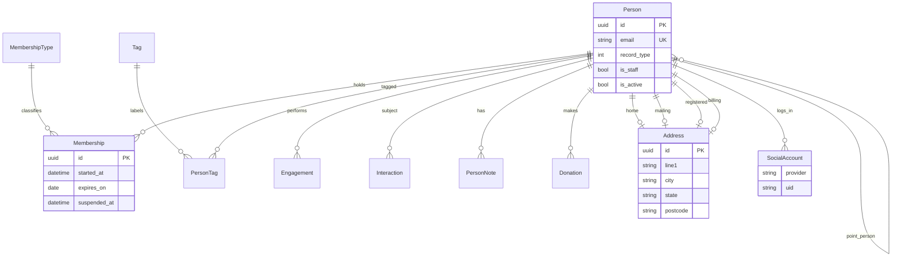
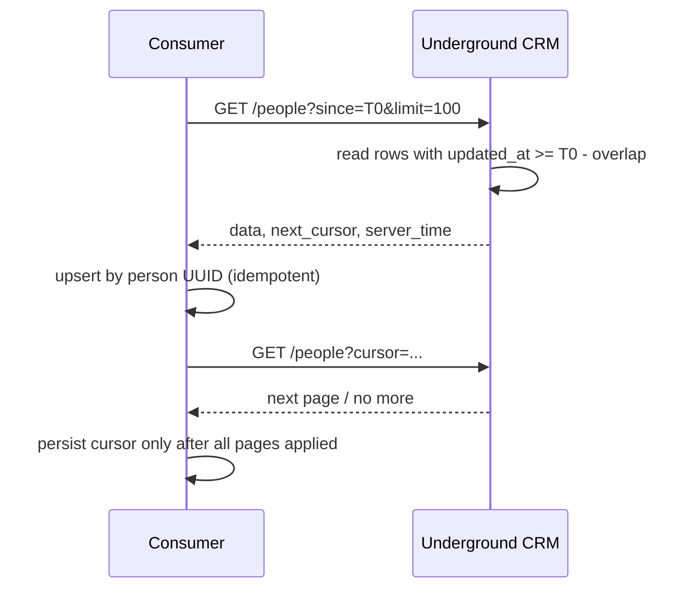
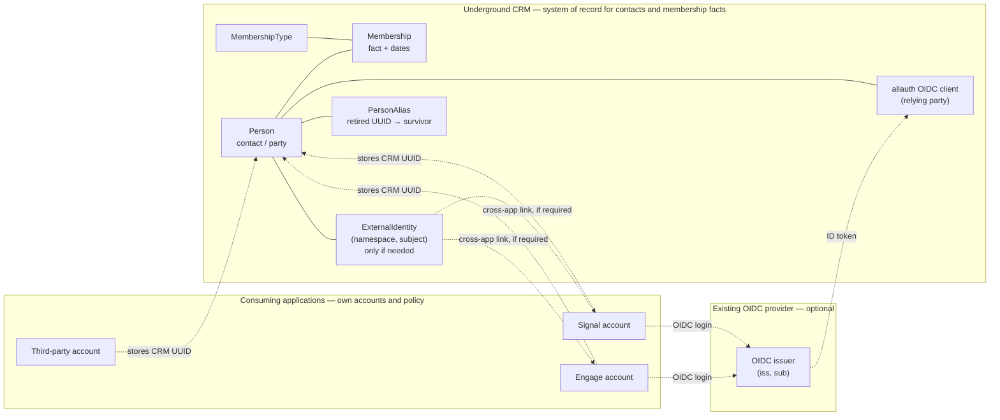
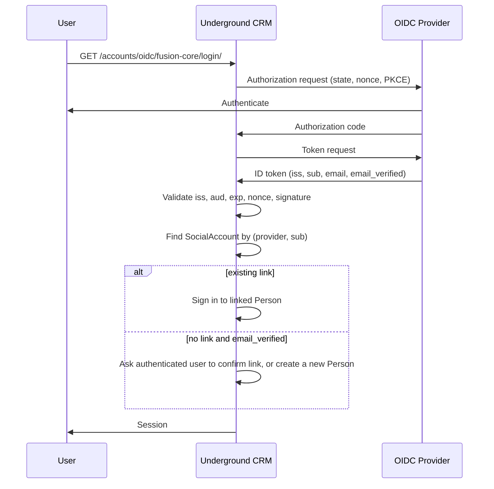

# RFC 0001 — Identity, Membership, and Integration Architecture

| | |
|---|---|
| **Status** | Draft for discussion — no decision has been made |
| **Date** | 2026-11-13 |
| **Repository** | Underground CRM |
| **Context** | Builds on the open read-only people feed PR #83 (`feat/generic-people-integration-api`, commit `6bcdadf`) |
| **Audience** | Underground CRM maintainers, and maintainers of the applications that may consume it |
| **Scope** | Architecture research and proposal. This document does not modify application logic, schemas, or deployment configuration. |

## Maintainer summary

This is the one-page version. The full research, sources, and trade-offs follow.

### Actual problems

1. **`Person` is both the contact record and the Django auth principal.** Every contact is therefore a potential login, and `is_active` means both "tombstone" and "cannot sign in".
2. **External identities are only partially represented.** `allauth.SocialAccount` stores login identities, but there is no generic way to link an Engage, Signal, or unrelated application account to a CRM person.
3. **Membership is a mutable fact with weak lifecycle data.** It has no history, no cancellation reason, no renewal chain, and no organisation scope. That is adequate for the current party-membership use case but weak for audit and future federation.
4. **The read-only people feed is a good foundation with edge cases.** It is replayable and scoped, but its `updated_at` watermark can miss late commits, hard deletes vanish, and there is no alias for a merged person. For a read-only pilot these are documented risks with mitigations; they become blockers for writes or routine merges.
5. **The CRM is not a general integration platform yet.** It has no `Person` write API, no OpenAPI schema, no outbound event system, and only coarse field-level scopes.

### Top recommendations

| Priority | Recommendation |
|---|---|
| 1 | **Document the identity boundary** and field ownership before adding infrastructure. |
| 2 | **Harden the existing read-only feed** — overlap/reconciliation semantics, field-level scopes, RFC 9457 errors, request IDs, and a written versioning policy. |
| 3 | **Keep `ExternalIdentity` and `PersonAlias` conditional.** Consumer-side CRM UUID mappings are sufficient initially. Add the registry only when the triggers in §6.2.1 are met. |
| 4 | **Do not make the CRM an identity provider.** Use an existing OIDC provider and keep the CRM as a relying party and contact/membership authority. |
| 5 | **Do not build an organisation/relationship model for the initial Engage integration.** That integration concerns Fusion party membership, which the current `MembershipType`/`Membership` model already represents. |
| 6 | **Do not add webhooks, custom fields/EAV, SCIM for contacts, or a contact write API now.** Revisit only on a demonstrated consumer requirement. |

### Proposed decisions for maintainers

- **Identity boundary:** the CRM remains authoritative for contacts and membership facts; consumers keep their own accounts; OIDC supplies authentication where needed.
- **First integration contract:** read-only, UUID-based, cursor/since reconciliation, consumer-side mapping. Tombstones and aliases are **risk mitigations**, not prerequisites for a read-only pilot.
- **Scope of this RFC:** research and options. It does not request approval to implement Strategic recommendations.
- **v1 compatibility:** a best-effort, additive-first policy. No fixed SLA or support window is asserted here; any date must be agreed by maintainers.
- **Fusion Core:** not required for the current integration. OIDC may remove the need for a custom authentication service, but it does not settle whether separate shared organisational infrastructure is useful.

### Explicit non-goals

- CRM as an OIDC/OAuth provider or identity provider.
- Fusion-specific code or a custom identity protocol.
- A new organisation/relationship model for the initial Engage integration.
- Outbound webhooks/outbox, generic custom fields/EAV, GraphQL, SCIM for contacts, multi-tenancy, or splitting `AUTH_USER_MODEL` in this cycle.
- Automatic person merging by email or fuzzy matching.
- Storing external access/refresh tokens in the CRM.

> **How to read this document.** Claims are labelled where the distinction matters:
>
> - **Observation** — what the repository actually does today.
> - **Evidence** — an upstream specification, documented behaviour, or inspected source.
> - **Assumption** — a belief that has not been verified and should be tested.
> - **Recommendation** — a proposal for discussion, not a decision.
>
> The RFC deliberately separates the problem from the proposed solution. A reader should be able to reject every recommendation and still accept the problem statement.

## Contents

1. [Executive summary](#1-executive-summary)
2. [Current architecture and constraints](#2-current-architecture-and-constraints)
3. [Problem statement](#3-problem-statement)
4. [Research methodology and sources](#4-research-methodology-and-sources)
5. [Comparative architecture findings](#5-comparative-architecture-findings)
6. [Proposed improvements](#6-proposed-improvements)
7. [Alternatives considered](#7-alternatives-considered)
8. [Compatibility, privacy, and security implications](#8-compatibility-privacy-and-security-implications)
9. [Incremental implementation options](#9-incremental-implementation-options)
10. [Open questions for maintainers](#10-open-questions-for-maintainers)
11. [Recommended next steps](#11-recommended-next-steps)
12. [Appendices](#appendix-a--current-model-inventory)

---

## 1. Executive summary

Underground CRM already contains most of the primitives a general-purpose, client-agnostic CRM integration needs. It has stable UUID primary keys, a person/contact record, temporal memberships, tags, consent and contactability flags, an audit history on `Person`, `django-allauth` for federated login, and a new scoped, read-only people feed. The most important gaps are not missing infrastructure. They are **identity boundaries and change semantics**.

The central finding is that four different things are currently described as "the same person":

1. a **CRM contact** (`Person`), which is the organisation's record of a human or organisation;
2. an **authentication principal**, which today is also `Person` because `AUTH_USER_MODEL` points at it;
3. an **external identity**, such as an OIDC subject or an application account, which is a link asserted by another system; and
4. a **membership**, which is a time-bounded fact about a contact's relationship with the organisation, not an account and not an entitlement decision.

The current model represents (1) and (2) in one table, represents some of (3) through `allauth`'s `SocialAccount`, and represents (4) as a simple row with start, expiry, and suspension dates. That is workable for a single application and for the initial Engage scope (Fusion party membership), but it makes cross-application identity resolution ambiguous. Federated-organisation membership would be a further gap only if a consumer actually needs it; it is not part of the initial Engage requirement.

The strongest recommendation is therefore deliberately modest:

> **Define and document the identity contract first. Keep the CRM as the authoritative source of contact and membership facts, but not as an identity provider. Start with consumer-side mapping and the stable CRM UUID. Add a small, read-only-first external identity link registry only if two or more consumers need to resolve the same human across applications.**

That approach preserves the CRM's independence, avoids turning it into an OAuth/OIDC authorization server, and lets each consumer keep its own account model. It also gives the project a proportionate answer to the "do we need Fusion Core?" question: **Fusion Core is not required for the current integration.** A standards-compliant OIDC provider plus `django-allauth` covers login federation, and the existing scoped bearer-token feed covers service-to-service reads. OIDC may eliminate the need for a custom authentication service, but it does not settle whether separate shared organisational infrastructure is useful for other reasons. If Fusion Core exists for independent product reasons, it can be integrated as one OIDC provider among others; it should not become a hard dependency or a custom protocol.

### Summary of recommendations

| ID | Recommendation | Level | Decision suggested |
|---|---|---|---|
| M1 | Document the identity model and field ownership | Minimal | Adopt |
| M2 | Tighten change-feed semantics and completeness | Minimal | Adopt |
| M3 | Add field-level scopes, sparse fieldsets, and standard errors | Minimal | Adopt |
| M4 | Fix credential logging and review social-login auto-linking | Minimal | Adopt |
| M5 | Normalise and audit email identity without breaking existing data | Minimal | Adopt after a duplicate report |
| M6 | Define membership integrity rules and audit existing rows | Minimal | Adopt |
| M7 | Publish a versioning, deprecation, and OpenAPI/contract policy | Minimal | Adopt |
| S1 | Add a read-only-first external identity link registry | Strategic | Conditional; only on a §6.2.1 trigger |
| S2 | Add merge-safe person aliases | Strategic | Conditional; only on a §6.2.1 trigger |
| S3 | Model organisations and affiliations only when a real requirement exists | Strategic | Defer |
| S4 | Model consent provenance only when a consumer needs per-purpose consent | Strategic | Defer |
| S5 | Add a narrow, idempotent contact write API | Strategic | Defer |
| S6 | Move integration clients from environment JSON to managed records | Strategic | Defer until more than a few clients |
| L1 | Add an outbox and signed webhooks | Long-term | Defer |
| L2 | Support OIDC/JWT resource-server auth or SCIM | Long-term | Defer; likely unnecessary |
| L3 | Build an electorate/geography model | Long-term | Defer; domain-specific |
| L4 | Build a typed extension-field API for themes | Long-term | Defer; prefer theme models |
| L5 | Split `Person` from the auth principal | Long-term | Do not do without a compelling reason |

The explicit non-goals are in §6.5. They include making the CRM an OIDC provider, adding Fusion-specific code, adding webhooks now, building a generic custom-field/EAV engine, and splitting `AUTH_USER_MODEL`.

---

## 2. Current architecture and constraints

### 2.1 What the project is

**Observation.** Underground CRM is a pip-installable Django library, not a standalone site. A downstream "theme" project installs it and supplies branding, templates, and organisation-specific page models. The repository describes itself as an open-source, vendor-neutral CRM/CMS/bulk-email toolkit for political parties and grassroots movements. [R1][R2]

**Observation.** The project is licensed AGPL-3.0-only and uses:

- Django `>=5.2,<6.0` (installed: 5.2.19);
- Wagtail `>=6.0,<7.0` (installed: 6.4.2);
- Django REST Framework `>=3.15` (installed: 3.18.3);
- `django-allauth[socialaccount]>=65.0` (installed: 65.22.1);
- `django-simple-history`, `django-taggit`, `django-money`, `django-q2`, `django-robots`, `django-phonenumber-field`, and `djangorestframework-simplejwt`. [R3]

**Observation.** The repository has 813 tests across the CRM, email, and payments apps. The 18 tests added in PR #83 for the integration feed pass locally. A full local run without Redis produced 84 errors whose traces are dominated by `ConnectionRefusedError` from Redis; CI starts a Redis service. The claim here is only that the suite is substantial and that integration tests can be run in isolation. [R24][R38]

### 2.2 Domain model and relationships

**Observation.** The core models are:

| Model | Purpose | Key relationships and fields |
|---|---|---|
| `Person` | Contact **and** auth user (`AUTH_USER_MODEL`) | UUID PK; unique email; `record_type` person/organisation; names; addresses; phone/email consent flags; staff flags; electoral district strings; recruiter/point-person self-FKs; `updated_at`; simple-history. [R5] |
| `Address` | Reusable structured address | UUID PK; lines, city, state, postcode, country; geocode and G-NAF ID. Person has four OneToOne address roles. [R7] |
| `MembershipType` | A category of membership | UUID PK; unique name. No code, organisation, duration, or external ID. [R6] |
| `Membership` | A person's membership of a type over time | UUID PK; person FK; type FK; `started_at`; `expires_on`; `suspended_at`; computed `is_active`. No history, cancellation reason, renewal link, or organisation. [R6] |
| `Engagement` | Single-action engagement log | UUID PK; person FK; action type; page URL/title; `recorded_by`; metadata JSON. [R8] |
| `Interaction` | Staff–person contact log | UUID PK; person FK; author FK; method; note; status. [R9] |
| `PersonNote` | Staff-only free text | UUID PK; person FK; author; legacy activity ID. [R10] |
| `Donation` | Individual donation | UUID PK; person FK; money; Stripe payment ID; recurring flag; metadata. [R11] |
| `Tag` / `PersonTag` | Free-form labels and mailing lists | UUID PK on tag and through model; `was_authenticated` on the through model; protected tags cannot be deleted. [R5][R21] |
| `SocialAccount` (allauth) | Federated login identity | `provider` + `uid` unique; FK to `Person`; `extra_data`. [R-allauth] |
| Wagtail pages | CMS content, forms, events, registration pages | `RegistrationPage` can grant a `MembershipType` on submission. [R12][R13] |



**Observation.** `Person.record_type` distinguishes `TYPE_PERSON` from `TYPE_ORGANISATION`, but there is no separate organisation model, no organisation-specific name field, no affiliation/relationship model, and no way to express "person A is an employee/member of organisation B". An organisation is a `Person` row with person-shaped fields and a required email. [R5]

**Observation.** `Person` is the `AUTH_USER_MODEL` (`settings.py:131`). It therefore carries both contact data and authentication state: `password`, `is_staff`, `is_admin`, `is_superuser`, groups, permissions, `is_active`. `is_active` is used both as a login flag and as a tombstone ("Inactive users are treated as tombstones"). [R4][R5]

**Observation.** The electoral geography is stored as five free-text `CharField`s on `Person`: `federal_district`, `state_upper_district`, `state_lower_district`, `council_district`, `ward`. There are no stable codes, no effective dates, no assignment history, and no `Electorate` model. The People filter treats them as text. [R5][R30]

**Observation.** Communication preferences are a small set of booleans and timestamps on `Person`: `email_opt_in`, `unsubscribed_at`, `mobile_opt_in`, `do_not_call`, `do_not_contact`, `email_is_bad`, `is_mobile_bad`, `is_deceased`, plus tags. There is no per-channel/per-purpose consent record, no source/provenance, and no per-tag consent record beyond `PersonTag.was_authenticated`. [R5][R21]

**Observation.** `Membership` has no `simple_history` registration and no immutable lifecycle event. Cancelling a membership from the visitor UI overwrites `expires_on` with today's date, losing the original expiry. [R14] The registration form avoids creating a second membership of the same type, but the self-service membership API does not. [R13][R16]

### 2.3 Authentication, permissions, and access control

**Observation.** Authentication is email-based. `Person.USERNAME_FIELD = "email"` and the custom `PersonManager` requires an email. There is no username. [R5] The project exposes both custom email/password views (`/join/`, `/login/`) and allauth's `/account/` URLs; allauth supplies the social-login callback and account-management surface, and its authentication backend is enabled. [R4][R33]

**Observation.** Federated login is provided by `django-allauth`. The repository configures Discord, Facebook, and a generic `openid_connect` provider (currently used for LinkedIn). [R4] The generic provider uses `sub` as the allauth `uid` by default and reads `email_verified` into allauth's email-address verification state. [R-allauth] The project's social adapter maps names and profile pictures into `Person`; it does not create a generic external identity. [R22]

**Observation.** `SOCIALACCOUNT_EMAIL_AUTHENTICATION = True` and `SOCIALACCOUNT_EMAIL_AUTHENTICATION_AUTO_CONNECT = True` are enabled. A social login with a verified email matching an existing `Person` will sign into that person and permanently connect the social identity. The settings comments describe this as intentional for trusted providers. [R4] Discord is configured as `VERIFIED_EMAIL: True`; Facebook is overridden to `VERIFIED_EMAIL: True`; LinkedIn relies on its OIDC verification. [R4]

**Observation.** Staff API access is coarse. `IsCRMStaff` returns true for any authenticated `is_staff` user; there is no object-level or role-level permission check on notes, interactions, engagements, donations, or addresses. [R17] `is_admin` is used for a narrow HTML-permission rule in the Django admin, not for API authorization. [R31]

**Observation.** There are three separate integration credentials/mechanisms:

- `INTEGRATION_API_TOKENS`: a JSON list of named bearer tokens with scopes, read from the environment. [R4][R18]
- `DISCORD_MEMBERSHIP_INTEGRATION_TOKEN`: a single token and membership-type UUID for the Discord eligibility endpoint. [R4][R20]
- Staff session/JWT credentials for the DRF API. [R4][R16]

**Observation.** The integration tokens are compared over SHA-256 digests with `hmac.compare_digest`, fail closed when unconfigured, never log the token, and require `people:read`. [R18] One older integration endpoint writes the presented credential to its failure log, which is a concrete credential-handling defect. [R20] A separate, narrowly scoped security fix with regression coverage is being prepared; it is not part of this RFC.

### 2.4 Public and internal APIs

**Observation.** The API surface is:

| Surface | Authentication | Capabilities | Documentation |
|---|---|---|---|
| `/api/integrations/v1/people/` and `/people/{uuid}/` | Scoped bearer token (`people:read`) | Read people, memberships, electorate, consent flags; cursor/since pagination; email lookup | `docs/integration_api.md` [R25] |
| `/api/integrations/discord/membership/{id}/` | Dedicated bearer token | Boolean eligibility only | `docs/discord_membership.md` [R26] |
| `/api/tags/`, `/notes/`, `/interactions/`, `/engagements/`, `/donations/`, `/addresses/` | Staff session/JWT (`IsCRMStaff`) | Staff CRUD, filtered by `?person=` | Not documented in `docs/` [R16] |
| `/api/memberships/` | Authenticated visitor | Create/delete the visitor's own memberships only | Not documented in `docs/` [R16] |
| `/api/me/` | Session, `AllowAny` with auth-aware response | Current visitor profile, optional billing context, whitelisted tags | Not documented in `docs/` [R16] |
| `/api/token/`, `/api/token/refresh/` | SimpleJWT | Staff/visitor JWT | Not documented in `docs/` [R15] |
| Wagtail CMS/admin | Session | Editorial and administrative UI | README [R2] |

**Observation.** There is **no `Person` endpoint** in the staff DRF API. The staff API exposes notes, interactions, engagements, donations, addresses, tags, and self-service memberships, but not the contact record itself. [R16] The only machine-to-machine people-read surface is the new integration feed; the admin UI and `/api/me/` are not substitutes for a contact API.

**Observation.** Wagtail's API v2 module is not installed in `INSTALLED_APPS`; there is no headless content API exposed by default. [R4] Wagtail v2 is also planned for deprecation in favour of a v3 API built on Django Ninja, with OpenAPI 3.1 and RFC 7807 errors. [E32]

**Observation.** The integration feed returns a `{data, meta}` envelope, `Cache-Control: no-store`, bounded `limit` (1–200), an opaque base64 cursor over `(updated_at, id)`, and `401` (with `WWW-Authenticate: Bearer`), `403`, and `503` responses. Errors are `{"error": "..."}`, not RFC 9457 problem details. [R19]

### 2.5 Integration and extension mechanisms

**Observation.** Existing extension points are Django-native rather than a plugin system:

- a downstream theme app can add models, templates, settings, and Wagtail page subclasses;
- downstream themes are instructed to extend `Person` via `OneToOneField` or `JSONField`, never by modifying the library's models; [R1]
- signals exist for subscription creation, membership changes, address geocoding, event guests, email confirmation, and protected tags; [R21]
- `django-q2` runs background tasks;
- management commands provide CLI-only imports and exports;
- inbound webhooks exist for Stripe payments (signature verified with Stripe's library) and SMTP2Go email events (shared-secret bearer token); SMTP2Go webhooks can be registered with a management command; [R27][R28][R29]
- RSS/Atom feeds and external feed subscriptions exist for CMS content. [R2]

**Observation.** There is no registry of integration clients, no outbound webhook/event system, no API schema, and no per-consumer field filtering beyond the single `people:read` scope.

### 2.6 Data semantics: people, organisations, memberships, relationships, geography, activities, preferences

**Observation.** The model is person-centric with a polymorphic `record_type` flag. It can represent an organisation as a `Person`, but:

- the required unique email is awkward for an organisation and prevents a contact with no email; the CSV importer works around this with synthetic `no-email-<id>@import.invalid` addresses; [R23]
- there is no organisation name field separate from `first_name`/`last_name`;
- there is no affiliation/relationship edge between people and organisations;
- `Membership` attaches to a `Person`, not to an organisation;
- `MembershipType` has only a name, so it cannot say which organisation the membership belongs to. [R5][R6]

**Observation.** The model can express "Priya has a Full member membership from 1 January to 31 December". It cannot express "Priya is an employee of Acme; Acme is a member; therefore Priya is entitled to member benefits". CiviCRM models the latter through relationships and inherited memberships; Salesforce models multiple affiliations through `AccountContactRelation`. [E7][E8][E10]

**Observation.** Activities are split across `Engagement` (single action), `Interaction` (staff contact), `PersonNote` (private note), and `Donation` (transaction). They share a person FK but no common activity interface, event ID, or change feed. [R8][R9][R10][R11]

### 2.7 Tests and backward-compatibility requirements

**Observation.** The project has a substantial test suite and explicit compatibility conventions:

- 813 tests across 56 test modules (local run: 18 integration tests pass; full suite needs Redis for queue-dependent tests). [R24][R38]
- all library-owned models use UUID primary keys; M2M through models must declare UUID PKs; Wagtail pages keep integer PKs and may add a secondary UUID if federation requires it; [R1]
- downstream themes must never create migrations touching `underground_crm` models; [R1]
- the library owns its migrations and cleans history only after applying migrations; [R1]
- the integration feed is versioned in the URL (`/v1/`) and deliberately read-only. [R25]

**Observation.** PR #83's feed tests cover fail-closed configuration, token/scope rejection, data minimisation, electorate fields, email lookup without membership, UUID detail lookup, membership status, stable pagination, invalid cursors, bounded page sizes, and the membership-deletion signal. [R24] They do not cover concurrent writers, hard deletion, membership-type renames, or email case collisions.

### 2.8 Genuine limitations versus undocumented or underused features

| Item | Classification | Why |
|---|---|---|
| `Person` is both contact and auth user | **Genuine architectural limitation** | Every contact is a potential login; auth state and CRM state cannot evolve independently; `is_active` has two meanings. |
| No external identity registry beyond `SocialAccount` | **Genuine limitation for multi-app integration** | `SocialAccount` is login-specific; non-login application accounts have no CRM-side link. |
| No organisation/affiliation model | **Not needed for initial Engage; future limitation if federated membership appears** | `record_type` is only a flag; no edges, roles, or dates. The initial Engage scope is party membership, which the current `Membership` model covers. |
| Membership lifecycle is a single mutable row | **Genuine limitation for audit and entitlements** | No history, no cancellation reason, no renewal chain; cancellation overwrites expiry. |
| No person merge/alias | **Genuine limitation for durable external links** | A dedupe or delete can orphan an external app's stored CRM UUID. |
| Free-text electoral geography | **Deliberate boundary / limitation** | The feed says the consumer owns mapping to its own geography; stable codes would be a separate data project. |
| Cursor feed with `updated_at` | **Sound foundation with edge cases** | Replayable and simple; wall-clock watermarks, hard deletes, and related-field changes need care. |
| `django-allauth` OIDC support | **Existing but underused** | Generic OIDC is configured for LinkedIn; adding another provider is configuration, not architecture. |
| `SocialAccount` for Discord eligibility | **Existing but narrowly used** | A good precedent for "external identity → person → membership", but one-off. |
| Simple-history on `Person` | **Existing but underused** | Contact field changes are audited; memberships, tags, addresses, and notes are not. |
| Tag-based mailing lists | **Existing but semantically overloaded** | Tags are labels, lists, and audiences at once; `was_authenticated` and `SELF_QUERYABLE_TAGS` are partial consent controls. |
| DRF staff API | **Existing but undocumented** | Useful for staff tooling; no `Person` resource; not an external integration contract. |
| Inbound Stripe/SMTP2Go webhooks | **Existing but inbound-only** | Good signature/secret patterns; no outbound event system. |
| Wagtail page APIs | **Not enabled** | Wagtail API v2 is not installed; content integration is out of scope for this RFC. |

### 2.9 Constraints imposed by Django and Wagtail

**Evidence.** Django's documentation states that changing `AUTH_USER_MODEL` after database tables exist is possible but complex: it affects foreign keys and many-to-many relationships, requires manual schema and data work, and the user model must be created in the app's first migration because of swappable-model dependency rules. It also advises reusable apps not to implement a custom user model. [E44] Underground CRM is a reusable app that *does* implement one; that decision is already made and should not be undone casually.

**Observation.** Wagtail's `Page` base class uses integer PKs because of `treebeard`; the project convention is to add a secondary UUID if stable page identifiers are needed. [R1] Wagtail 6.x is pinned; Wagtail's v2 API is planned for deprecation and v3 introduces OpenAPI 3.1 and RFC 7807. [E32] Any content API strategy should account for that upgrade path, but it is not the subject of this RFC. The app config also sets `UUIDAutoField` as the default auto field, which is a safety net rather than a substitute for explicit through models. [R37]

**Observation.** The project uses PostgreSQL in production and SQLite in tests; `JSONField`, partial indexes, and transactional behavior differ. Any concurrency-sensitive change (change feed, unique constraints, outbox) needs PostgreSQL-specific testing as well as SQLite coverage. [R2][R38]

---

## 3. Problem statement

### 3.1 A concrete scenario

Priya is a party member. She has:

- a CRM `Person` record, `P`;
- a CRM `Membership` row, `M`, of type "Full member";
- an Engage account, `E`, which she uses to participate in organisational business;
- a Signal account, `S`, which she uses to receive communications;
- optionally, an OIDC login at a shared identity provider, `O`, with subject `sub=abc123`.

The CRM knows `P` and `M`. Engage knows `E`. Signal knows `S`. The identity provider knows `O`. If each application stores its own mapping from its account to `P`, the system works for one-to-one integrations. But:

- if `P` is duplicated and later merged, Engage's and Signal's stored `P` UUIDs may point at a deleted or non-canonical record;
- if a new consumer needs to know whether `E` and `S` are the same human, there is no shared link to consult;
- if the CRM uses `email` as the matching key, a changed, shared, reassigned, or case-variant address can merge the wrong people or split the right one;
- if the CRM becomes the identity provider, it takes on password storage, MFA, recovery, session management, and token issuance — responsibilities it was not designed for and that are easy to get wrong.

### 3.2 Requirements

| ID | Requirement | Why it matters |
|---|---|---|
| G1 | A stable, opaque CRM contact identifier that survives renames and email changes | External systems must be able to store a durable link. |
| G2 | A way to represent external identities without conflating them with the contact | OIDC subjects and application accounts are links, not people. |
| G3 | Membership facts with clear lifecycle and provenance | Consumers need to decide eligibility without guessing. |
| G4 | A way to represent organisational affiliation if a consumer needs it | "Organisational membership" is ambiguous in the current model. |
| G5 | Channel/purpose-aware communication preferences | Consent is not a single boolean; different consumers need different subsets. |
| G6 | Replayable, incremental reads with tombstone/merge semantics | Consumers must reconcile after downtime and after dedupe. |
| G7 | Least-privilege credentials and field minimisation | The feed contains personal information; one token should not grant everything. |
| G8 | Independence from any particular consumer or identity provider | The CRM must remain reusable by other parties and deployments. |
| G9 | Backward compatibility for existing deployments and themes | The library owns migrations; downstream themes cannot be forced to rewrite. |
| G10 | Operational simplicity proportionate to a small open-source project | A volunteer-maintained CRM should not need a Kafka cluster to integrate. |

### 3.3 Non-requirements

- The CRM does not need to authenticate end users on behalf of other applications.
- The CRM does not need to store external access tokens or refresh tokens.
- The CRM does not need to be a general-purpose identity provider, authorization server, or SCIM directory.
- The CRM does not need real-time push for the initial integrations; scheduled pull is acceptable.
- The CRM does not need a generic custom-field engine for this problem.
- The CRM does not need to model every Australian electoral geography to expose a person's district names.

### 3.4 Integration test cases

These are architectural test cases, not requirements to hardcode. Each should be satisfiable through generic capabilities, without any consumer's name appearing in the CRM code.

| Test case | What the consumer needs to do | Generic CRM capability | Gap or decision |
|---|---|---|---|
| **Engage** | Resolve a member identity; verify **Fusion party membership**; read geographic information; reconcile after downtime. | Stable `Person.id`; scoped people read; `Membership`/`MembershipType` with `is_active`; electorate fields; cursor/since feed. | The initial Engage scope is party membership, not federated organisational membership. The current `Membership` model is sufficient; no organisation/relationship model is needed for this integration. Reconciliation uses consumer-side mapping and periodic full reads; aliases/tombstones are optional mitigations, not blockers. |
| **Signal** | Read contact data, communication preferences, and authorised audiences. | Scoped people read; `email_opt_in`/`unsubscribed_at`/`do_not_contact`/`mobile_opt_in`; tags. | Current preferences are coarse; per-purpose consent (S4) may be needed for a later scope. "Authorised audience" needs a defined tag/consent contract; tags are not consent by themselves. Organisational relationships are out of scope unless Signal later demonstrates a need. |
| **Fusion Core** | Provide shared identity and authentication while the CRM remains authoritative for contacts and memberships. | OIDC relying party via `django-allauth`; `(iss, sub)` in `SocialAccount`; optional `ExternalIdentity` link. | Fusion Core is **not required** for the current integration. OIDC may remove the need for a custom authentication service, but not necessarily future shared organisational infrastructure. If Fusion Core exists, integrate it as a standard OIDC provider; do not add a custom protocol. |
| **Unrelated third-party app** | Integrate without knowing about Engage, Signal, or Fusion. | One bearer token per client; generic `/people/` contract; UUID + cursor; documented scopes; OpenAPI. | Needs the documentation, scopes, and error/versioning work (M3, M7). It must not need any consumer-specific field or endpoint. |

The test is passed only if the third-party case requires **no knowledge of the other consumers**. If a capability only makes sense for one consumer, it belongs in that consumer, not in the CRM core.

---

## 4. Research methodology and sources

### 4.1 Method

1. **Repository inspection.** Read the models, settings, API, signals, forms, admin, tests, documentation, migrations, and dependency metadata. Ran the integration test module and a full local suite to establish a baseline. [R1]–[R38]
2. **Upstream specifications.** Read the OIDC Core, SCIM, HTTP problem-details, deprecation/sunset, and API design guidance. [E1]–[E4], [E28]–[E31]
3. **Open-source implementations.** Inspected `django-allauth`'s `SocialAccount` and generic OIDC provider source in the installed environment; read CiviCRM's contact/user linkage, relationships, membership inheritance, and merge documentation; read Keycloak, Authentik, and Zitadel documentation for identity-provider and SCIM capabilities. [R-allauth][E5]–[E9], [E33]–[E35]
4. **Commercial API behaviour.** Read the public documentation for Salesforce, HubSpot, Stripe, GitHub, Microsoft Graph, Contentful, and Sanity. [E10]–[E27]
5. **Privacy and security guidance.** Read GDPR principles, the Australian Privacy Principles, and OWASP guidance on federated account linking and email verification. [E37]–[E40]
6. **Comparative analysis.** For each pattern, asked: what problem does it solve, how does it work, what would it cost here, and is it generally useful or client-specific?

### 4.2 Evidence grading

- **A — inspected code or specification.** Directly read in this repository or an upstream specification. Highest confidence.
- **B — official product documentation.** Authoritative for that product's behaviour, but not a statement about what Underground CRM should do.
- **C — secondary analysis.** Useful for context, not relied on for a factual claim about a protocol.

Most claims below are A or B. Assumptions are labelled.

### 4.3 Limits

- No private APIs, authenticated consoles, or production data were accessed.
- No proprietary implementation code was copied.
- Documentation changes over time; URLs and behaviours are as observed on 2026-11-13.
- The legal discussion is architectural, not legal advice.
- The research did not include interviews with the maintainers or the consumers; the open questions in §10 are the substitute.

### 4.4 Assumptions to test

These are not findings. They are the beliefs the recommendations depend on; each should be confirmed or falsified before implementation.

| ID | Assumption | How to test | Consequence if false |
|---|---|---|---|
| A1 | Consumers can store a CRM UUID and upsert by it idempotently. | Ask each consumer team to show its schema and retry logic. | A cursor feed and alias table are insufficient; a different contract is needed. |
| A2 | Scheduled pull is acceptable for the first integrations; near-real-time is not required. | Ask for latency/volume expectations. | Webhooks/outbox (L1) move from "defer" to "needed". |
| A3 | The initial Engage integration concerns Fusion party membership, not federated organisational membership. | Confirm the consumer's definition of the entitlement. | If a federated-organisation requirement appears later, S3 becomes a separate proposal; it is not needed now. |
| A4 | Consumers can map free-text electorate names to their own geography. | Ask for their mapping and error rate. | L3 (stable geography codes) becomes more urgent. |
| A5 | There are only a few initial consumers, so consumer-side mapping is sufficient. | Count the consumers and cross-app resolution needs. | S1 (identity registry) becomes justified sooner. |
| A6 | PostgreSQL is the production database; SQLite tests are not sufficient for concurrency-sensitive changes. | Confirm deployment matrix. | Change-feed and unique-index designs need a different approach. |
| A7 | Maintainers prefer additive, low-infrastructure changes over new platforms. | Discuss this RFC. | The recommended phasing may be too conservative. |
| A8 | Fusion Core's standards compliance is unknown. | Ask what protocols and claims it supports. | Do not integrate until it is OIDC-compliant or an adapter is agreed. |
| A9 | Consumers can implement retries, backoff, and idempotent processing. | Review their integration design. | The CRM must provide stronger delivery guarantees or simpler semantics. |
| A10 | A retention/erasure policy can be agreed before identity links are stored. | Raise it with maintainers and privacy owners. | S1 should not be implemented. |

---

## 5. Comparative architecture findings

### 5.1 Contact, user, and account are separate concepts

| System | Contact/person | Authentication principal | External account link | Lesson |
|---|---|---|---|---|
| CiviCRM | `Contact` (individual, household, organisation) | CMS user (Drupal/WordPress/Joomla) | `civicrm_uf_match` maps CMS user to contact; not every contact has a user | A CRM contact and a login are different populations. [E5][E6] |
| Salesforce | `Contact` / `Account` / Person Account | `User` (internal staff or external community user) | External users are tied to a Contact; internal Users are not | The `User` object is an authentication/authorisation record, not the customer record. [E11] |
| HubSpot | `Contact` / `Company` / custom objects | `User`/owner | Associations and external IDs | Ownership and record identity are separate from login. [E14] |
| OIDC | — | Relying party's local user | `(iss, sub)` is the only stable identifier | Email and `preferred_username` are not stable identifiers. [E1] |

**Observation.** CiviCRM's documentation is explicit that "most CMS users have a corresponding CiviCRM contact record; however, the relationship is not a strict 1-1", and lists four permutations: user defined/contact defined, user defined/contact missing, neither, and contact defined/user missing. [E6] That is precisely the distinction Underground CRM currently collapses.

**Recommendation.** Treat `Person` as the contact/party record. Treat authentication as an optional capability of a person, not as the definition of a person. Do not add a second "user" table in this RFC; instead, document that a `Person` may have no usable password, no social account, and no staff role, and make that explicit in the API and admin.

### 5.2 The party/relationship model is a useful abstraction for organisations, but not needed now

**Evidence.** Martin Fowler's Analysis Patterns describes `Party` as a supertype of `Person` and `Organisation`, and `Accountability` as a typed relationship between parties, used when simple hierarchies are insufficient. [E41] Salesforce's `AccountContactRelation` is a junction object with `AccountId`, `ContactId`, `Roles`, `IsActive`, `StartDate`, and `EndDate`. [E10] CiviCRM represents relationships between contacts with a relationship type, start/end dates, permissions, and optional membership inheritance. [E7][E8]

**Observation.** Underground CRM already has a `Party`-like model in `Person.record_type`, but no relationship edge. It therefore has the supertype without the graph.

**Recommendation.** Do not build an organisation/relationship model for the initial Engage integration; it concerns party membership, which the current `Membership` model represents. If a federated-organisation requirement later appears, prefer a small typed `Relationship` edge between `Person` rows (with start/end dates and a role) over a new `Organisation` model. It reuses the existing Party record, avoids duplicating names/addresses, and supports employment, membership, household, and branch relationships. Add `MembershipType.organisation` only if memberships must belong to different organisations. Do not build a full organisation hierarchy or membership-inheritance engine now.

**Pitfall.** CiviCRM's inherited memberships are powerful but can loop: its own documentation describes a relationship cycle that creates inherited memberships indefinitely, and an extension exists specifically to guard against it. [E8] Any inheritance feature should be explicit and cycle-safe, not automatic recursion.

### 5.3 External identity linking

| Pattern | Reference | Mechanism | Relevance |
|---|---|---|---|
| OIDC subject | OIDC Core §2, §5.7, §8; Discovery 1.0 | `(iss, sub)` is locally unique and never reassigned; email may change or be reused; public vs pairwise subjects are advertised in discovery | The correct key for any OIDC login or token. [E1][E2] |
| SCIM `externalId` | RFC 7643 §3.1 | Client-assigned identifier scoped to the provisioning domain; server `id` is immutable; `meta.version` is an ETag | A standard way to let a provisioning client correlate its record with the CRM's. [E3] |
| allauth `SocialAccount` | `allauth/socialaccount/models.py` | `unique_together(provider, uid)`; `uid` is the provider subject; `extra_data` holds claims | Existing login-identity storage; not a general app-account registry. [R-allauth] |
| Salesforce External ID | Salesforce docs | External ID fields support upsert and cross-system matching | Useful for idempotent writes, but not a substitute for a link table. [E10] |
| Salesforce Data 360 key-ring | Salesforce Trailhead | Links a person across source systems while preserving source context, instead of forcing a single golden record | Supports a link registry over destructive merging. [E42] |
| HubSpot `idProperty` | HubSpot docs | Upsert by a unique property such as email | Convenient, but email is a weak key; use only with validation. [E14] |

**Recommendation.** Use `(namespace, subject)` as the generic link key, with `namespace` identifying the asserting system and `subject` being that system's opaque identifier. For OIDC, `namespace` can be the provider/issuer alias and `subject` is `sub`; store `issuer` separately if the provider can change. Never use email as the link key. Never store access tokens in the link record.

### 5.4 Identity resolution and merge safety

**Evidence.** CiviCRM provides supervised and unsupervised duplicate rules and a merge workflow; merged contacts' related records move to the surviving contact, and the merge is not reversible without database logging. [E9] HubSpot explicitly says merged records cannot be unmerged; it exposes "Merged record IDs" properties so integrations can see what was merged. [E15] Salesforce's guidance distinguishes "merge in the system of record when appropriate" from "do not merge; use profile linkage/key-ring" when source context must be preserved. [E42]

**Observation.** Underground CRM has no duplicate rule, no merge action, and no alias table. A hard delete or an administrative edit can therefore break any external system that stored the person UUID. [R31]

**Recommendation.** Prefer linking over merging. If merging is added, make it supervised, audited, and alias-preserving: keep a `PersonAlias` row mapping the old UUID to the surviving person, touch the survivor's `updated_at`, and return the canonical ID from the API. Do not auto-merge on email. Do not reuse an old UUID for a different person.

### 5.5 Membership is a fact; entitlement is a decision

**Evidence.** CiviCRM distinguishes contacts from memberships and supports multiple memberships per contact, membership statuses, and inherited memberships through relationships. [E8][E9] Stripe's Entitlements API treats an entitlement as "a customer's access to a feature", derived from a subscription, and recommends that the application persist the entitlement and provision access from it. [E20] Salesforce separates the customer `Contact` from the `User` licence and permission sets. [E11]

**Recommendation.** The CRM should expose membership **facts** — type, start, expiry, suspension, cancellation, and optionally the organisation — and let each consumer derive its own entitlement. Do not add a generic `Entitlement` model to the CRM. An entitlement is policy-specific: Engage's "can vote" and Signal's "can receive the members' bulletin" are different decisions from the same membership fact.

**Pitfall.** A membership row is not a status enum. Expiry, suspension, cancellation, and renewal are separate events; collapsing them into a single mutable `status` field loses history and makes reconciliation harder.

### 5.6 Incremental synchronisation and change tracking

| System | Pattern | Tombstones | Notes |
|---|---|---|---|
| Salesforce | `getUpdated()` / `getDeleted()` replication calls | Yes, `getDeleted()` | Returns IDs and timestamps; client retrieves current records; 30-day window. [E12] |
| Microsoft Graph | Delta query with `@odata.nextLink` / `@odata.deltaLink` | Deleted items have a `deleted` facet | State token is opaque; replication delays are expected; restart full sync if token invalid. [E23] |
| Contentful | Sync API with `nextSyncToken` / `nextPageUrl` | `DeletedEntry` / `DeletedAsset` | Initial sync returns everything; subsequent syncs return changes and deletions; tokens are opaque and may require a full resync. [E24] |
| Sanity | Listen API with resume tokens | `disappear` transition | Events may arrive out of order; clients reassemble by revision/timestamp; transaction IDs group mutations. [E25] |
| Underground CRM (proposed) | Cursor over `(Person.updated_at, Person.id)` | Only via `is_active`; hard deletes disappear | Replayable; membership delete touches the person; no tombstone for hard delete; wall-clock watermark. [R19] |

**Observation.** PR #83's cursor is a good fit for a small project: it is replayable, needs no broker, and lets a consumer reconcile from the beginning. Its weaknesses are the classic ones:

1. **Wall-clock watermark.** `updated_at` is set when the SQL statement runs, not when the transaction commits. A transaction that sets an earlier timestamp can commit after a later one, so a consumer that has advanced its cursor can miss it. Multiple application servers with clock skew make this worse.
2. **Hard deletes.** A deleted person disappears; a consumer cannot distinguish "deleted" from "never existed" or "out of scope".
3. **Related-field changes.** Membership changes are handled by touching the person, but `MembershipType.name` changes are not; tags, addresses, notes, and interactions do not touch the person. This is acceptable only while the feed's contract is limited to person core + memberships + electorate + consent flags.
4. **Initial population.** The first page without `email`, `cursor`, or `since` includes only people with at least one membership; supporters without memberships are invisible. This is a deliberate minimisation, but it limits generic use.
5. **Type renames.** Consumers should key on `type_id`, not `type_name`; the feed does not signal a rename.

**Recommended read pattern.**



**Recommendation.** Keep the pull feed. Add a documented overlap/settling window for `since`/cursor reads, expose a server timestamp, and document at-least-once semantics and idempotency. For the first read-only integration, tombstones and aliases are **risk mitigations, not prerequisites**: avoid hard deletes and merges during the pilot, have consumers store their own account ID as well as the CRM UUID, and run a periodic full reconciliation. Add tombstones/aliases when consumers must survive merges or deletes, or when the CRM starts accepting writes. Do not build a webhook/outbox system until the pull feed is insufficient.

### 5.7 Webhooks, events, and delivery guarantees

**Evidence.** The Standard Webhooks specification defines `webhook-id`, `webhook-timestamp`, and `webhook-signature`, signs `id.timestamp.body` with HMAC-SHA256 (or Ed25519), uses the ID as an idempotency key, and supports multiple signatures for zero-downtime secret rotation. [E22] Stripe recommends verifying signatures against the raw body, rejecting old timestamps (default 5 minutes), and returning 2xx before complex processing. [E18] The transactional outbox pattern stores the event in the same database transaction as the business change, then a relay publishes it; delivery is at-least-once and consumers must be idempotent. [E26] A known limitation of a naive polling outbox is that sequence/timestamp order may not match commit order; log-based CDC avoids that. [E27]

**Observation.** Underground CRM has inbound webhook verification patterns (Stripe signatures, SMTP2Go shared secret) but no outbound event system. [R27][R28] PR #83 deliberately chose pull over webhooks because it is replayable. [R19]

**Recommendation.** Do not add webhooks now. If they are added later, use the transactional outbox, Standard Webhooks headers/signatures, per-endpoint secrets, retries with exponential backoff, a dead-letter store, and idempotent consumers. Do not hand-roll a signature scheme. Do not make webhooks the only integration path; keep the pull feed for reconciliation.

### 5.8 API versioning and compatibility

| System | Versioning | Support policy | Lesson |
|---|---|---|---|
| Stripe | Date-based version, `Stripe-Version` header; account default; webhook endpoints pin a version | Monthly non-breaking, twice-yearly major; webhook versions are pinned | Versioning is a product capability, not just a URL. [E17] |
| GitHub | Calendar version in `X-GitHub-Api-Version`; unversioned requests use the oldest supported version | Previous version supported at least 24 months; `Deprecation`/`Sunset` headers; `410 Gone` after retirement | Explicit pinning plus a long support window works. [E21] |
| Salesforce | Path version `/services/data/vXX.0/`; a new version per release | Long support windows; warnings then `410` for retired versions | Path versioning is simple and visible. [E13] |
| Underground CRM | Path `/api/integrations/v1/` | Not yet written | Path v1 is proportionate; add a written policy. [R25] |

**Recommendation.** Keep path-based `/v1/`. Within v1, allow only additive changes: new optional query parameters, new response fields, new enum values that consumers must tolerate, new endpoints. Breaking changes go to `/v2/`. Publish a **best-effort** support expectation rather than a fixed SLA; if maintainers later agree a retirement date, use `Deprecation` (RFC 9745) and `Sunset` (RFC 8594) headers and return `410 Gone` after it. Do not adopt date-based versioning for one endpoint; it adds ceremony without a multi-product need. [E29]

### 5.9 Errors, pagination, filtering, and schema

**Evidence.** RFC 9457 defines `application/problem+json` with `type`, `title`, `status`, `detail`, and `instance`. [E28] Google's AIP-158 requires pagination from the outset, opaque page tokens, and a documented default/maximum page size; AIP-160 describes a filter syntax. [E30] OpenAPI 3.1 aligns with JSON Schema 2020-12. [E31] Wagtail's v3 API uses OpenAPI 3.1 and RFC 7807. [E32]

**Observation.** The current feed uses a clear `{data, meta}` envelope and a bounded `limit`, but errors are ad-hoc strings and there is no schema or field selection. [R19]

**Recommendation.** Adopt RFC 9457 for errors, add an `X-Request-Id`, add a `fields` parameter with a token-level allowlist, and publish an OpenAPI 3.1 document with examples. Keep the existing pagination shape; it is already cursor-based and opaque. Add `meta.server_time` so consumers can reason about clock skew.

### 5.10 Custom fields and schema extensibility

**Evidence.** Salesforce allows 500–800 custom fields per object depending on edition (hard limit 900 for some objects) and exposes a Metadata API for definitions. [E43] HubSpot exposes custom properties, custom objects, associations, and a limits-tracking endpoint for custom properties. [E14][E16] Both are products with schema editors, validation, indexing, permissions, and migration tooling.

**Observation.** Underground CRM's documented extension path is a downstream theme `OneToOneField` or `JSONField` on `Person`, never modifying the library's models. [R1] There is no API exposure for those extension fields.

**Recommendation.** Do not build a generic custom-field/EAV engine. It is a product in its own right and a common source of query complexity, validation gaps, and data leakage. If an integration needs extension data, expose a small, explicitly registered `extensions` object from the theme, with field-level scopes and a documented contract. Prefer typed Django fields over arbitrary JSON.

### 5.11 Identity providers and provisioning

**Evidence.** Keycloak supports OIDC/SAML identity brokering and an Organizations feature with members, invitations, identity-provider links, and organization claims. [E33] Authentik provides OIDC and a SCIM provider that syncs users and groups to external applications, with full sync and per-provider filtering. [E34] Zitadel provides OIDC, SAML, and a SCIM 2.0 server (preview) with Users, Groups, and Bulk endpoints. [E35] WorkOS provides AuthKit, SSO, Directory Sync/SCIM, and organization memberships. [E36]

**Observation.** Underground CRM already has a standards-compliant OIDC relying party through `django-allauth`; the generic provider is configured for LinkedIn and uses `sub` as the account UID. [R4][R-allauth] It does not need to become an identity provider to accept an OIDC login.

**Recommendation.** Treat any OIDC provider as an interchangeable login adapter. If a shared identity service is needed, use an existing IdP (Keycloak, Authentik, Zitadel, WorkOS, Entra, etc.) rather than building one. If provisioning is needed, SCIM is the standard for users/groups, not for CRM contacts and memberships. Do not make the CRM a SCIM server for contacts.

### 5.12 Privacy and consent boundaries

**Evidence.** GDPR Article 5 requires purpose limitation, data minimisation, accuracy, storage limitation, and integrity/confidentiality; Article 7 requires demonstrable consent and easy withdrawal; Article 17 provides a right to erasure. [E39] The OAIC's APP 3 requires collection to be reasonably necessary and adopts data minimisation; APP 6 limits use/disclosure to the primary purpose or a permitted secondary purpose; APP 11 requires reasonable security and destruction/de-identification when no longer needed. [E40] OWASP warns that auto-linking accounts by email is an account-takeover primitive and recommends `(iss, sub)` plus explicit, authenticated linking. [E37]

**Observation.** The CRM holds personal information, including membership and donation data. The integration feed exposes names, emails, electorate, membership, and consent flags. Tokens are bearer credentials configured in the environment. [R4][R19] The feed is read-only and excludes notes, tags, donations, interactions, and addresses. [R25]

**Recommendation.** Make data minimisation concrete: per-token field allowlists, separate scopes for membership/geography/preferences, no email enumeration without a `people:match` scope and rate limiting, no external tokens stored, and a documented retention/erasure policy for identity links. Treat external identity links as personal data: they can reveal that a person has an account in another system.

### 5.13 Developer experience

**Observation.** The new `docs/integration_api.md` is unusually good for a small project: it documents field ownership, authentication, rotation, endpoints, pagination, reconciliation, deployment sequencing, and tests. [R25] The older Discord doc is similarly clear. [R26] The staff DRF API has no equivalent documentation.

**Recommendation.** Build on this style. Add an integrator index, a quickstart with curl and a minimal Python example, a capabilities endpoint, a changelog, and an OpenAPI document. Document what is *not* exposed as carefully as what is. Provide a sandbox/test token pattern and a "reconciliation checklist" for consumers.

### 5.14 Pattern fit summary

| Pattern | Problem it solves | What would change in Underground CRM | Complexity | Verdict |
|---|---|---|---|---|
| Contact vs auth principal separation | Prevents every contact from being a login; clarifies `is_active` | Documentation first; a real split would require a new user model | Low (docs) / very high (split) | Adopt the boundary in docs; reject the split for now (L5) |
| Party + typed relationship | Represents organisations and affiliations | New `Relationship`/`RelationshipType`, optional `MembershipType.organisation` | High | Defer until a consumer needs it (S3) |
| External identity registry | Links OIDC subjects and app accounts to a contact | New `ExternalIdentity` table, admin, scoped read API | Medium | Conditional on trigger (S1) |
| Merge aliases / key-ring | Keeps external links valid across dedupe | New `PersonAlias`, canonical resolution in API | Medium | Prototype with S1 (S2) |
| Membership inheritance | Derives membership through relationships | Relationship model plus inheritance engine and cycle guards | High | Reject now; expose facts, let consumers decide |
| Entitlement model | Centralises access decisions | A policy engine in the CRM | High | Reject; entitlements belong to consumers |
| Cursor/delta feed | Replayable incremental synchronisation | Already implemented; harden semantics and tombstones | Low–medium | Adopt and harden (M2) |
| Webhooks + outbox | Near-real-time push | Outbox table, relay, signing, retries, DLQ, monitoring | High | Defer (L1) |
| Path API versioning + deprecation headers | Predictable compatibility | Policy, headers, changelog, contract tests | Low | Adopt (M7) |
| RFC 9457 + OpenAPI 3.1 | Machine-readable errors and schema | Error helper, schema document, tests | Low–medium | Adopt (M3, M7) |
| Generic custom fields / EAV | Arbitrary per-tenant attributes | Schema engine, validation, indexing, permissions | Very high | Reject; use theme models |
| CRM as OIDC provider | Shared login | Issuer, keys, flows, MFA, recovery, consent | Very high | Reject |
| SCIM server | Standard user/group provisioning | SCIM endpoints, schemas, auth, bulk | High | Defer/reject for contacts; consider staff only |
| Organisation membership inside the IdP | B2B SSO org context | Conflates IdP groups with paid/expiring membership | Medium | Reject as a replacement for CRM membership |
| Event sourcing / CDC | Perfect audit/order | New infrastructure and operational expertise | Very high | Reject now |
| Multi-tenancy | One deployment, many organisations | Tenant column on every model, permissions, constraints | Very high | Reject |

---

## 6. Proposed improvements

### 6.0 Design principles

1. **The CRM is the system of record for contacts and membership facts; it is not the system of record for authentication or entitlements.**
2. **Prefer stable, opaque identifiers over natural keys.** UUIDs for CRM records; `(iss, sub)` for OIDC; `(namespace, subject)` for application accounts; never email.
3. **Prefer consumer-side mapping over new central infrastructure** until a second consumer demonstrates the need for a shared registry.
4. **Prefer pull/reconciliation over push** for a small, volunteer-maintained project; add push only when latency or volume requires it.
5. **Every new field is a privacy and maintenance liability.** Expose the minimum, scope it, document it, and make it removable.
6. **Do not make the CRM depend on any particular consumer, including Fusion.** Standards and configuration over bespoke code.

The intended shape is:



The CRM is a relying party and a data source. It is not the issuer of credentials, and it does not decide what an entitlement means for a consumer.

### 6.1 Minimal improvements

These are small, mostly documentation-and-hardening changes. None require a new architectural component.

#### M1. Document the identity model and field ownership

**Problem.** The repository has excellent model-level comments but no single document that explains the difference between a `Person`, an auth principal, a `SocialAccount`, a `Membership`, and a consumer account.

**Proposal.** Add `docs/identity_model.md` (or a section in `docs/integration_api.md`) covering:

- the four entities and their identifiers;
- which system is authoritative for each field;
- what "active", "inactive", "deceased", "unsubscribed", and "do not contact" mean, and their precedence;
- what a consumer may store and what it must not infer;
- what happens on person merge/delete (even if the answer is "not supported yet");
- the rule that email is a matching convenience, not an identity key.

**Compatibility.** No code change. **Effort:** 1–2 days. **Risk:** none.

#### M2. Tighten change-feed semantics and completeness

**Problem.** The feed is replayable, but its watermark and tombstone semantics are underspecified, and some related-field changes are invisible.

**Proposal.**

1. Add `meta.server_time` and `meta.overlap_seconds` (or document a fixed overlap) to the response.
2. Define `since` as inclusive and recommend that consumers re-read a small overlap window and de-duplicate by person UUID. Document that delivery is at-least-once.
3. Add explicit tests for: a membership type rename; a hard-deleted person; a person updated by `QuerySet.update()`; two concurrent transactions with out-of-order commits (as far as SQLite/Postgres tests allow); a person with no membership in the initial population.
4. Decide whether hard deletion is supported. If not, make `Person.delete()` a soft delete or document that consumers must treat a missing person as "unknown, reconcile fully".
5. If `MembershipType.name` is part of the payload, touch the persons holding that type on rename, or document that `type_name` is a label and `type_id` is the key.
6. Add a `population` or `include` parameter (for example, `include=members|all`) gated by a token scope, so a consumer that legitimately needs supporters can ask for them without changing the default minimisation.

**Compatibility.** Additive response fields and query parameters. Touching persons on type rename is a write amplification but small. **Effort:** 3–5 days including tests. **Risk:** low.

**Assumption.** Consumers can tolerate an overlap window and idempotent upserts. This should be confirmed with Engage and Signal.

**Proportionality.** For the first read-only integration, these are documented risks, not blockers. The mitigations are: do not hard-delete or merge people during the pilot; use `is_active` as the tombstone; have the consumer store its own account ID as well as the CRM UUID; run a periodic full reconciliation and alert if it falls behind; and make upserts idempotent. The risks become blockers only when the CRM accepts writes, performs merges, or serves many consumers.

#### M3. Add field-level scopes, sparse fieldsets, and standard errors

**Problem.** One `people:read` scope grants every exposed field, including email, electorate, memberships, and consent flags. A consumer that only needs eligibility should not receive all of it. Errors are ad-hoc.

**Proposal.**

- Keep `people:read` as the v1 umbrella for backward compatibility.
- Add optional granular scopes, for example `people:read.memberships`, `people:read.geography`, `people:read.preferences`, and `people:match` for email lookup. A token's effective fields are the intersection of its scopes and the requested `fields`.
- Do **not** remove email lookup from an existing `people:read` token within v1. Apply `people:match` to new tokens, or introduce it in a v2. A backward-compatible tightening is possible only if the existing consumers agree.
- Add `fields=id,email,memberships` to list and detail requests. Unknown or unauthorised fields are omitted (or rejected with a 400; choose one and document it). The response `meta` should echo the effective fields.
- Add `application/problem+json` errors with stable `type` URIs, a human `title`, a `status`, a `detail`, and an `instance` request ID.
- Add `X-Request-Id` to every response and include it in logs.
- Add `ETag`/`If-None-Match` on the detail endpoint and `Last-Modified` where useful.
- Add a `GET /api/integrations/v1/` capabilities endpoint: feed version, server time, supported scopes, maximum page size, and deprecation policy.

**Compatibility.** Additive for existing clients if `people:read` still implies all current fields. New tokens can be narrower. **Effort:** 3–5 days. **Risk:** low–medium (contract tests needed). Do not turn the scope change into a breaking change for the open PR's first consumer.

#### M4. Fix credential logging and review social-login auto-linking

**Problem.** A confirmed credential-handling defect exists in an older integration endpoint: a failed authorization can write the presented credential to the log. [R20] The specific endpoint and fix are being handled in a **separate, narrowly scoped security PR with regression coverage**, not bundled into this documentation-only RFC PR. Separately, global email-based auto-connect is convenient but is an account-takeover primitive if any accepted provider does not verify email ownership. [E37]

**Proposal.**

1. Never log the `Authorization` header. Log only the client name, the outcome, and a request ID. Add a regression test with a synthetic token asserting it does not appear in captured logs. **Effort:** hours.
2. Review `SOCIALACCOUNT_EMAIL_AUTHENTICATION` and `..._AUTO_CONNECT` per provider. Require `email_verified=true` for any provider that can auto-connect. For a new generic OIDC provider (including a shared identity service), either disable auto-connect or require an explicit, authenticated link confirmation. Notify the person when a new login method is linked. [E37][E38]
3. Document the trust level of each provider and the consequences of adding another.

**Compatibility.** Disabling auto-connect changes login behaviour for new users who rely on email matching; they will be asked to sign in and link explicitly. That is a deliberate security trade-off and should be announced. **Effort:** 1–2 days including tests. **Risk:** low–medium (user experience).

#### M5. Normalise and audit email identity without breaking existing data

**Problem.** `Person.email` is unique at the database level, but PostgreSQL uniqueness is case-sensitive. `PersonManager.normalize_email` lowercases only the domain, while lookup uses `iexact`. [R5][R19] `Foo@example.com` and `foo@example.com` can therefore coexist, and the integration feed's email lookup may return two rows. Some code paths compare with `email=` (case-sensitive). [R23] A contact without an email cannot be represented, so the importer creates synthetic addresses. [R23]

**Proposal.**

1. Add a management command `audit_person_emails` that reports case-insensitive duplicates, synthetic/placeholder addresses, invalid addresses, and people sharing a domain. Do not change the schema in the same step.
2. Decide the canonical comparison policy: store the original address for display and a canonical form for comparison; apply it consistently in signup, login, password reset, subscription, import, and API lookup. [E38]
3. After cleanup, add a functional unique index on `Lower("email")` (Postgres) with a migration and a documented rollback. Consider a `canonical_email` field if the original must be preserved.
4. Do **not** make `email` nullable in this RFC. That is a larger change tied to the auth model (see L5). Document the placeholder pattern as technical debt.

**Compatibility.** The audit command is additive. The unique index can fail on existing duplicate data; it must be preceded by a report and a cleanup path. **Effort:** 2–4 days plus data cleanup. **Risk:** medium (data migration).

#### M6. Define membership integrity rules and audit existing rows

**Problem.** `Membership` has no database constraint preventing two active memberships of the same type for one person. The registration form checks, but the self-service API does not. [R13][R16] Cancellation overwrites `expires_on`, losing the original term. [R14] There is no history.

**Proposal.**

1. Define the domain invariant explicitly. For example: "a person may hold at most one active membership of a given type; renewals extend or replace the term according to a documented rule." If multiple concurrent rows are legitimate, say why.
2. Add `audit_memberships` to report duplicate active rows, expired rows with no replacement, suspensions older than a threshold, and memberships with `started_at` in the future.
3. Add `simple_history` to `Membership` (and optionally `MembershipType`) so lifecycle changes are auditable.
4. Add `clean()` validation on `Membership` for `expires_on >= started_at` and a clear error for duplicate active rows. Do not add a database partial unique constraint that depends on `CURRENT_DATE`; PostgreSQL does not allow non-immutable predicates.
5. Consider adding `cancelled_at` and `cancellation_reason` rather than overwriting `expires_on`; keep the old field for compatibility during a transition.

**Compatibility.** History and audit commands are additive. `clean()` may reject data that currently saves; run the audit first. **Effort:** 2–4 days. **Risk:** low–medium.

#### M7. Publish a versioning, deprecation, and contract policy

**Problem.** The feed is `/v1/` but there is no written policy for additive changes, deprecation, or consumer expectations. Consumers cannot plan.

**Proposal.** Add a short `docs/api_versioning.md` and a section in `docs/integration_api.md`:

- v1 accepts additive changes only;
- breaking changes require v2;
- a **best-effort** support expectation for v1 after a v2 is proposed. Do not assert a fixed SLA or a 12-month window as an obligation. If maintainers later choose a date, record it then; until then, say that v1 will remain while the project can support it and that consumers should watch the changelog;
- `Deprecation` and `Sunset` headers, plus `410 Gone` after retirement, **when a retirement date is actually agreed**; [E29]
- a changelog file and a test that the OpenAPI document matches the implemented response shape;
- the current maximum page size and any rate-limit behaviour that actually exists. Do not document limits the project has not implemented.

**Compatibility.** Documentation only. **Effort:** 1 day plus ongoing discipline. **Risk:** none. The policy must reflect maintainer capacity, not create an obligation the project cannot meet.

### 6.2 Strategic improvements

These are reusable capabilities, but each needs a demonstrated requirement. They are deliberately not all recommended for immediate implementation.

#### 6.2.1 Triggers for revisiting S1 and S2

Consumer-side mapping is the default. Each consumer can store the CRM `Person.id` (and its own account ID) in its own database; that is enough for a one-to-one integration. The CRM does not need to hold the mapping.

Revisit **S1 (ExternalIdentity)** when any of these is true:

| Trigger | Why it changes the decision |
|---|---|
| **Two or more consumers need to resolve the same human across applications** (for example, Engage needs to know that a Signal account is the same person). | Point-to-point mapping cannot answer the cross-application question; a shared registry can. |
| **A consumer cannot store its own mapping** (for example, a managed service or a stateless relay with no durable store). | The link must live somewhere; the CRM is the natural shared source. |
| **An administrator needs to audit or repair links centrally** after a merge, migration, or dispute. | Per-consumer mappings are invisible to CRM staff and hard to reconcile. |
| **A regulatory or contractual requirement** demands a single record of which external accounts are linked to a person. | The registry becomes an accountability artefact, not just a convenience. |

Do **not** revisit S1 merely because a new consumer is added, or because a "single identity graph" sounds architecturally attractive. A new consumer that only needs CRM↔itself mapping should keep that mapping locally.

Revisit **S2 (PersonAlias)** when any of these is true:

| Trigger | Why it changes the decision |
|---|---|
| **CRM staff need to merge duplicate people** and a consumer stores CRM UUIDs. | Without aliases, a merge silently breaks the consumer's link. |
| **Hard deletion of `Person` is unavoidable** (for example, an erasure request) and consumers must distinguish "deleted" from "never seen". | An alias/tombstone gives the consumer something to reconcile against. |
| **A consumer cannot tolerate a full reconciliation** after a merge or delete (for example, a large downstream store with expensive rebuilds). | Incremental alias/tombstone signals are cheaper than a full resync. |

For an initial **read-only pilot**, S2 is not a blocker. Mitigations are: do not merge duplicates during the pilot, avoid hard deletes, use `is_active` as the tombstone, have the consumer store its own external ID as well as the CRM UUID, and run a periodic full reconciliation. These are proportionate for a small number of trusted consumers. The risk becomes material when the CRM starts merging records, accepting writes, or serving many consumers.

#### S1. External identity link registry (conditional, read-only first)

**Problem.** There is no generic way to say "Engage account `member-4821` and Signal contact `sig_9f3` both refer to CRM person `P`". `SocialAccount` covers login providers only and is tied to allauth's authentication flow.

**Proposal.** Add a small model, for example:

```python
class ExternalIdentity(models.Model):
    id = models.UUIDField(primary_key=True, default=uuid.uuid4, editable=False)
    person = models.ForeignKey(
        "underground_crm.Person",
        on_delete=models.PROTECT,
        related_name="external_identities",
    )
    namespace = models.SlugField(max_length=100)  # "engage", "signal", "fusion-core"
    subject = models.CharField(max_length=255)     # opaque; case-sensitive
    issuer = models.URLField(blank=True)           # OIDC iss, when applicable
    kind = models.CharField(max_length=20, choices=...)  # oidc | account | legacy
    label = models.CharField(max_length=200, blank=True)
    metadata = models.JSONField(default=dict, blank=True)  # no tokens or secrets
    verified_at = models.DateTimeField(null=True, blank=True)
    created_at = models.DateTimeField(auto_now_add=True)
    updated_at = models.DateTimeField(auto_now=True)

    class Meta:
        constraints = [
            models.UniqueConstraint(fields=["namespace", "subject"], name="..."),
        ]
        indexes = [models.Index(fields=["person", "namespace"])]
```

**Key design decisions.**

- `(namespace, subject)` is unique. One external account maps to at most one person; one person may have many external accounts.
- `subject` is opaque and case-sensitive; never normalise it.
- `metadata` must not contain access tokens, refresh tokens, passwords, or full claim sets. It is for non-sensitive display/context only.
- `on_delete=PROTECT` prevents a silent cascade that would orphan consumers. A person deletion must be an explicit, reviewed operation (or a soft delete).
- `verified_at` records when the asserting service claimed verification; it is not a CRM authentication event.
- Do **not** store email in this table as a key.

**API surface (proposed).**

```http
GET /api/integrations/v1/identities/?namespace=engage&subject=member-4821
Authorization: Bearer <token with identities:read>

200 OK
{
  "data": {
    "namespace": "engage",
    "subject": "member-4821",
    "person_id": "3f0c0e42-6a5e-4e4a-9b5f-6f1c1e8a2d10",
    "kind": "account",
    "verified_at": "2026-11-01T09:00:00+11:00"
  },
  "meta": { "server_time": "2026-11-13T10:16:00+11:00" }
}
```

```http
GET /api/integrations/v1/people/3f0c0e42-.../identities?namespace=engage
Authorization: Bearer <token with identities:read>

200 OK
{
  "data": [
    { "namespace": "engage", "subject": "member-4821", "kind": "account" }
  ]
}
```

A future write endpoint would be idempotent and conflict-aware:

```http
PUT /api/integrations/v1/identities/engage/member-4821
Authorization: Bearer <token with identities:write>
Idempotency-Key: 6b1e...

{ "person_id": "3f0c0e42-...", "verified_at": "2026-11-01T09:00:00+11:00" }

201 Created
```

If the subject is already linked to a different person, return `409 Conflict` with a problem-details body. Do not silently re-link. Do not allow a consumer to link an identity to an arbitrary person unless it has a scoped `identities:write` permission and an audit trail.

**Relationship to `allauth`.** There are two viable implementations:

1. **Mirror:** on social login, upsert an `ExternalIdentity` with `namespace=provider_id`, `subject=uid`, `kind=oidc`. `SocialAccount` remains the authentication source of truth; the mirror is a rebuildable projection. The risk is dual-write drift.
2. **Union:** keep `SocialAccount` for login identities and `ExternalIdentity` for non-login accounts; the read API unifies them. The risk is two query paths and a more complex serializer.

This RFC recommends **option 2 for the first iteration**, because it avoids dual writes and keeps allauth authoritative. In that iteration the `ExternalIdentity` table holds only `account` and `legacy` rows; `kind="oidc"` exists so a one-way mirror can be added later without a schema change. If the union proves awkward, add the mirror. What matters is that the API presents one identity concept to consumers.

**Compatibility.** New table and endpoints; no change to existing models. **Effort:** 1–2 weeks for read-only model/admin/API/tests. **Risk:** medium (new personal-data store; needs privacy review). **General usefulness:** high if more than one consumer needs cross-application resolution; low if each consumer only maps to CRM.

**Decision trigger.** See §6.2.1. Do not merge S1 until one of those triggers is met. For a single consumer, a consumer-side `crm_person_id` column is simpler and sufficient.

#### S2. Merge-safe person aliases (conditional)

**Problem.** Any external system that stores a CRM person UUID will break if the person is merged or hard-deleted. CiviCRM and HubSpot both warn that merges are hard to reverse; Salesforce recommends a key-ring rather than forcing a golden record in some cases. [E9][E15][E42]

**Proposal.** Add a `PersonAlias` model:

```python
class PersonAlias(models.Model):
    id = models.UUIDField(primary_key=True, default=uuid.uuid4, editable=False)
    alias_id = models.UUIDField(unique=True)  # the retired person UUID
    person = models.ForeignKey("underground_crm.Person", on_delete=models.CASCADE, related_name="aliases")
    reason = models.CharField(max_length=200, blank=True)
    created_at = models.DateTimeField(auto_now_add=True)
```

- A merge creates an alias row, moves dependent records to the survivor, touches the survivor's `updated_at`, and records an audit entry.
- `GET /people/{uuid}/` resolves an alias to the survivor and returns `200` with `meta.canonical_id` and `meta.merged_into`, plus `Link: <...>; rel="canonical"`. Use `200`, not `301`: many API clients do not follow redirects, and a JSON body is easier to act on.
- The feed includes a `merged` or `deleted` section, or a separate `/aliases/` endpoint, so consumers can reconcile old IDs.
- Do not reuse a retired UUID.
- Make merge supervised and reversible at the alias level; do not auto-merge on email.

**Compatibility.** New table, additive API fields. **Effort:** 1–2 weeks with S1. **Risk:** medium (data integrity, admin UI). **General usefulness:** high for any consumer storing CRM IDs; more important before a write API or merge workflow, but not required for a read-only pilot.

#### S3. Organisations and affiliations, only on demonstrated need

**Problem.** `record_type=organisation` exists, but there is no affiliation edge, no organisation name field, and no way to scope a membership to an organisation. [R5][R6]

**Not needed for the initial Engage integration.** The initial Engage scope is Fusion party membership: a person holds a `Membership` of a `MembershipType`. The current model already expresses that. Do not build an organisation/relationship model for Engage. S3 is retained only as a conditional option for a future, separately justified requirement.

**Proposal (conditional).** If a consumer genuinely needs "organisation X is a member; person Y is an employee/office-holder of X; therefore Y inherits/qualifies", add:

```python
class RelationshipType(models.Model):
    id = UUIDField(pk=True)
    name = CharField(max_length=100, unique=True)
    reverse_name = CharField(max_length=100)
    is_symmetric = BooleanField(default=False)

class Relationship(models.Model):
    id = UUIDField(pk=True)
    from_person = ForeignKey(Person, related_name="relationships_from")
    to_person = ForeignKey(Person, related_name="relationships_to")
    type = ForeignKey(RelationshipType, on_delete=PROTECT)
    role = CharField(max_length=100, blank=True)
    started_at = DateField(null=True, blank=True)
    ended_at = DateField(null=True, blank=True)
    source = CharField(max_length=100, blank=True)
    metadata = JSONField(default=dict, blank=True)
```

And optionally `MembershipType.organisation = ForeignKey(Person, limit_choices_to={"record_type": TYPE_ORGANISATION}, null=True)`. This follows CiviCRM's "membership organisation" and Salesforce's `AccountContactRelation` rather than inventing a new `Organisation` table. [E8][E10]

**Do not** implement automatic membership inheritance. If it is ever needed, make it explicit, cycle-safe, and limited (CiviCRM's docs describe loops and a `Max related` cap). [E8]

**Compatibility.** New tables/fields; no change to existing data. **Effort:** 2–4 weeks with admin and tests. **Risk:** medium–high (domain complexity). **General usefulness:** medium; only if organisational membership is a real requirement. **Client-specific risk:** high if driven only by one consumer.

**Decision trigger.** A consumer must answer "is this person entitled through an organisation?" with data the CRM does not currently hold. That trigger is **not met** for the initial Engage integration, which concerns party membership. If "organisational membership" only means "membership of the party", the current `MembershipType` model is sufficient; do not build S3.

#### S4. Consent provenance, only on demonstrated need

**Problem.** The current booleans are coarse and have no provenance. A consumer cannot tell why someone is opted in, which list they joined, or when consent changed. [R5][R21]

**Proposal (conditional).** If a consumer needs per-channel/per-purpose consent, add an append-only `ConsentEvent` or `CommunicationPreference` model:

```python
class ConsentEvent(models.Model):
    id = UUIDField(pk=True)
    person = ForeignKey(Person, related_name="consent_events")
    channel = CharField(choices=[("email", ...), ("sms", ...), ("phone", ...), ("post", ...)])
    purpose = CharField(max_length=100)  # "newsletter", "campaign", "membership"
    status = CharField(choices=[("granted", ...), ("withdrawn", ...), ("unknown", ...)])
    source = CharField(max_length=200)   # form, import, webhook, staff
    evidence = JSONField(default=dict)   # no secrets
    occurred_at = DateTimeField()
    created_at = DateTimeField(auto_now_add=True)
```

Keep the existing `Person` fields as denormalised, backward-compatible projections for the current UI and reports. Document precedence: `do_not_contact` > `unsubscribed_at` > channel opt-in > unknown.

**Compatibility.** New table; existing fields remain. **Effort:** 3–5 weeks including UI and migration. **Risk:** high (regulated domain, data migration, semantics). **General usefulness:** medium–high for political parties, but it is a product area of its own. **Recommendation:** do not build now; first publish the precedence rules and expose the current fields with scopes.

#### S5. Narrow, idempotent contact write API

**Problem.** External applications cannot create or update contacts. The staff DRF API has no `Person` resource; the integration feed is read-only. [R16][R19] A consumer that needs to record a signup must ask CRM staff or use the admin.

**Proposal (conditional).** Add a scoped write endpoint with a deliberately narrow contract:

```http
POST /api/integrations/v1/people/
Authorization: Bearer <token with people:write>
Idempotency-Key: 4f2c...

{
  "email": "priya.sharma@example.com",
  "first_name": "Priya",
  "last_name": "Sharma",
  "external_identity": { "namespace": "engage", "subject": "member-4821" },
  "source": "engage-signup"
}
```

- Upsert only by `external_identity` (if supplied) or by a verified email with an explicit `match=email` flag; never silently merge.
- Whitelist fields; do not allow memberships, staff flags, donations, notes, or tags.
- Use `Idempotency-Key` and return the same response for a replay. [E19]
- Use `If-Match`/`updated_at` for updates, or a `PATCH` with an explicit `version` field.
- Return `409` on identity conflict; `422` on validation; `202` if the write is queued.
- Log the client, request ID, and changed fields; do not log the payload.

**Compatibility.** New endpoint and scope. **Effort:** 3–5 weeks including validation, tests, and abuse controls. **Risk:** high (write path, personal data, duplicate creation). **Recommendation:** defer until a consumer has a concrete need and S1/S2 exist. A read-only integration is a safer first contract.

#### S6. Managed integration clients

**Problem.** Tokens live in an environment JSON blob, with no rotation UI, last-used tracking, or per-client audit beyond the name. [R4][R18]

**Proposal (conditional).** Add an `IntegrationClient` model with a hashed secret, scopes, allowed namespaces/fields, `last_used_at`, `expires_at`, and `created_by`, managed in the Django admin. Keep the environment JSON as a bootstrap/fallback for small deployments.

**Compatibility.** Additive. **Effort:** 1–2 weeks. **Risk:** medium (secret handling). **Recommendation:** defer until there are more than a handful of clients or a rotation incident. Environment tokens are acceptable for one to three trusted services if rotation is documented.

### 6.3 Long-term possibilities

These are worth considering later but should not be committed to now.

| ID | Possibility | Why defer |
|---|---|---|
| L1 | Transactional outbox + signed webhooks | The pull feed is sufficient and simpler; webhooks add retries, signing, delivery monitoring, and a new failure surface. Add only when a consumer needs near-real-time or high volume. |
| L2 | OIDC/JWT resource-server auth or SCIM | The CRM does not need to validate third-party tokens for its own API; scoped bearer tokens are simpler. SCIM provisions users/groups, not CRM contacts/memberships. Consider only for staff SSO at scale. |
| L3 | Electorate/geography model | Domain-specific (Australian AEC/ABS data), large data-maintenance burden, and the current contract deliberately leaves mapping to consumers. Add only if multiple consumers need stable codes. |
| L4 | Typed extension-field API for themes | A generic schema API is a product in itself; theme `OneToOne` models plus explicit serializers are safer. Revisit if several themes need the same extension. |
| L5 | Split `Person` from the auth principal | Django's own docs warn that changing `AUTH_USER_MODEL` mid-project is complex; the library is a reusable app with a custom user model. The migration risk is disproportionate. Document the conflation and keep auth fields optional instead. |

### 6.4 Recommendation matrix

Scores are relative to this project: **Benefit** (interoperability/reuse), **Complexity** (design + code), **Operational cost**, **Migration risk**, **Maintenance**. Use Low/Medium/High.

| ID | Benefit | Complexity | Operational cost | Migration risk | Maintenance | General or client-specific | Suggested timing |
|---|---|---|---|---|---|---|---|
| M1 | High | Low | Low | None | Low | General | Now |
| M2 | High | Low–Med | Low | Low | Low | General | Now |
| M3 | High | Medium | Low | Low | Medium | General | Now |
| M4 | High (security) | Low | Low | Low–Med | Low | General | Now |
| M5 | Medium–High | Medium | Low | Medium | Medium | General | After audit |
| M6 | Medium | Medium | Low | Low–Med | Medium | General | After audit |
| M7 | High | Low | Low | None | Low | General | Now |
| S1 | High if multi-app | Medium | Medium | Medium | Medium | General | Conditional; §6.2.1 trigger |
| S2 | High | Medium | Medium | Medium | Medium | General | Conditional; with S1 |
| S3 | Medium | High | Medium | Medium | High | Client-specific risk | Defer |
| S4 | Medium–High | High | Medium | High | High | General but regulated | Defer |
| S5 | High | High | Medium–High | High | High | General | Defer |
| S6 | Medium | Medium | Low | Low | Medium | General | Defer |
| L1 | Medium | High | High | Medium | High | General | Defer |
| L2 | Low–Medium | High | Medium | Medium | High | General | Defer |
| L3 | Medium (AU) | High | High | Medium | High | Domain-specific | Defer |
| L4 | Medium | High | Medium | Medium | High | Theme-specific | Defer |
| L5 | Low (for this problem) | Very high | High | Very high | High | General | Reject |

### 6.5 Explicit non-goals: ideas that should NOT be implemented

| Idea | Why not |
|---|---|
| **Make Underground CRM an OIDC/OAuth provider or identity provider** | It would take on credential storage, MFA, recovery, session management, token issuance, consent screens, and a security surface the project is not designed for. Use an existing IdP. |
| **Build Fusion-specific identity code or a custom Fusion protocol** | Couples the CRM to one consumer and violates vendor neutrality. Fusion Core is not required for the current integration. If it speaks OIDC, configure it as a provider; if it does not, fix Fusion Core, not the CRM. |
| **Build an organisation/relationship model for the initial Engage integration** | The initial requirement is Fusion party membership, which `Membership`/`MembershipType` already represents. S3 is only for a later, separately justified federated-organisation requirement. |
| **Add outbound webhooks now** | The pull feed is replayable and simpler. Webhooks need an outbox, signing, retries, DLQ, monitoring, and idempotent consumers. Add later if latency demands it. |
| **Build a generic custom-field/EAV engine** | It is a product in itself: schema editor, validation, indexing, permissions, migrations, query complexity, and data leakage risk. Use theme models with explicit serialization. |
| **Split `AUTH_USER_MODEL` now** | Django documents the migration as complex; the library is a reusable app with a custom user model. The benefit does not justify the risk. |
| **Auto-merge duplicate people by email or fuzzy matching** | Email is not a stable identifier; auto-merge is an account-takeover and data-loss primitive. Use supervised merge with aliases. |
| **Store external access/refresh tokens in the CRM** | Unnecessary for the stated use cases and a high-value breach target. The CRM only needs opaque subject links. |
| **Expose notes, tags, donations, interactions, or addresses in the generic people feed** | They are internal/CRM-specific and not needed for identity, membership, geography, or communication preference. Add scoped endpoints if a consumer needs them. |
| **Add GraphQL now** | REST + cursor feed is sufficient; GraphQL adds schema, authorization, query-cost, and caching complexity for no demonstrated benefit. |
| **Build a SCIM server for contacts** | SCIM models users/groups for provisioning, not CRM contacts with memberships and consent. If staff provisioning is needed, use SCIM for staff users only, not contacts. |
| **Build a full electorate/geography service** | Domain-specific, data-heavy, and the current contract deliberately leaves mapping to consumers. |
| **Build a full consent management platform** | Regulated, product-specific, and easy to get wrong. Start with documented precedence and scoped exposure of existing fields. |
| **Add multi-tenancy or branch-scoped data isolation** | A major schema and authorization change; current deployments are single-organisation. Wagtail sites support multiple domains, not data segregation. |
| **Make `Person.email` nullable as part of this RFC** | It is entangled with `AUTH_USER_MODEL` and login. Treat as a separate, carefully migrated project. |
| **Adopt date-based API versioning for one endpoint** | It adds ceremony without a multi-product need. Path `/v1/` plus an additive-change policy is proportionate. |

---

## 7. Alternatives considered

### 7.1 Make the CRM the identity provider

**Why considered.** A shared identity service would give every application one login and one user ID. The CRM already has a `Person` table, allauth, and OIDC support.

**Why rejected.** Authentication is a security-critical product. The CRM would need to issue and rotate signing keys, implement OIDC discovery, authorization code flow with PKCE, token refresh, logout, consent, MFA, account recovery, session management, and abuse controls. It would also need to protect against account takeover and token theft. That is disproportionate for a volunteer-maintained CRM, and it duplicates mature IdPs. The CRM should be a **relying party**, not an **OpenID Provider**.

### 7.2 Build Fusion Core-specific integration

**Why considered.** Fusion has authority over its consuming applications and could standardise identity across them.

**Why not required now.** Fusion Core is not required for the current integration. A standards-compliant OIDC provider plus `django-allauth` is enough for shared authentication, and the scoped feed is enough for CRM data. OIDC may eliminate the need for a custom authentication service, but it does not settle whether separate shared organisational infrastructure (for example, a common directory of organisations, roles, or governance bodies) is useful for other reasons. That is a separate product question. Either way, Fusion-specific endpoints, claims, or IDs in the CRM would couple its release cycle to one consumer. If Fusion Core is an OIDC provider, it is one configuration entry. If it needs custom data, that belongs in the consumer, not the CRM core.

### 7.3 Use allauth `SocialAccount` as the only identity registry

**Why considered.** `SocialAccount` already stores `(provider, uid)` and links to `Person`; Discord eligibility uses it. [R-allauth][R20]

**Why insufficient.** It is designed for login providers. It does not represent a non-login application account, has no namespace for arbitrary apps, and its `uid` semantics are provider-specific. It is the right store for OIDC login identities, not for a general cross-application link registry.

### 7.4 Merge duplicates aggressively

**Why considered.** A single golden record is simpler for consumers.

**Why rejected.** Merges are hard to reverse (CiviCRM and HubSpot both warn), and source context matters. Prefer linking and aliases; if merging, make it supervised and reversible at the alias level. Salesforce's key-ring model is evidence that preserving context can be preferable to forcing one record. [E9][E15][E42]

### 7.5 Webhooks first

**Why considered.** Webhooks provide near-real-time updates and are standard in commercial CRMs.

**Why rejected for now.** The pull feed is replayable and has no delivery infrastructure. Webhooks add an outbox, signing, retries, DLQ, monitoring, and consumer idempotency. Add them when a consumer demonstrates a latency or volume requirement, and build them on the outbox pattern and Standard Webhooks. [E22][E26]

### 7.6 Generic custom fields/EAV

**Why considered.** Consumers may need to store application-specific attributes.

**Why rejected.** A schema engine is a large product surface. The existing theme `OneToOne`/`JSONField` extension is sufficient; expose it explicitly if needed. Salesforce/HubSpot invest heavily in metadata APIs and limits, which is a signal of the cost. [E43][E16]

### 7.7 GraphQL

**Why considered.** Flexible queries for multiple consumers.

**Why rejected.** REST with cursor pagination and sparse fieldsets covers the use cases. GraphQL adds query-cost analysis, per-field authorization, caching, and schema evolution complexity.

### 7.8 SCIM server now

**Why considered.** Standard provisioning; identity providers support it.

**Why rejected.** SCIM provisions users/groups, not CRM contacts and memberships. The CRM has few staff users and already supports OIDC JIT login. If staff provisioning becomes a requirement, implement SCIM for staff only, not for the contact database. [E3][E4]

### 7.9 Split `AUTH_USER_MODEL` now

**Why considered.** Separating contact and auth principal is conceptually cleaner.

**Why rejected.** Django's docs warn that changing `AUTH_USER_MODEL` after tables exist is complex; the library is a reusable app with a custom user model. [E44] The migration risk outweighs the benefit. Instead, document that auth is optional and keep the door open for a future major version.

### 7.10 Event sourcing / Kafka / CDC

**Why considered.** Strong audit and ordering guarantees.

**Why rejected.** Operationally disproportionate. A well-specified cursor feed plus an outbox (if needed later) is enough. Log-based CDC could solve outbox ordering, but it adds a dependency and operational expertise. [E27]

### 7.11 Multi-tenancy

**Why considered.** A single deployment might serve multiple parties or branches.

**Why deferred.** It changes every query, permission, and unique constraint. The current model is single-organisation per deployment; Wagtail sites are not a tenancy boundary. If needed, it should be a separate architectural project.

### 7.12 Make `Person.email` nullable now

**Why considered.** Contacts without email (phone-only, postal-only, organisations) are real.

**Why deferred.** `email` is the `USERNAME_FIELD` and unique. Making it nullable affects login, allauth, forms, imports, and the integration feed. The placeholder pattern is technical debt, but the fix is a separate identity-model project. Document it and avoid building new features that depend on synthetic addresses.

### 7.13 Date-based API versioning

**Why considered.** Stripe/GitHub use it successfully.

**Why rejected.** Those are large multi-product APIs with many breaking changes and dedicated platform teams. A single-endpoint CRM benefits more from a simple path version and a written additive-change policy.

---

## 8. Compatibility, privacy, and security implications

### 8.1 Backward compatibility

- **Minimal improvements** are additive: new response fields, new optional query parameters, new scopes that do not remove existing access, new documentation. Existing consumers continue to work.
- **ExternalIdentity** and **PersonAlias** are new tables. They do not alter existing columns. The only behavioural change is that a person deletion may be protected or soft-deleted; that needs a migration plan and a deprecation note.
- **Membership history** adds a table and writes; existing code continues to read the current row.
- **Email unique index** is the riskiest minimal change. It can fail on existing case-duplicates; it must be preceded by an audit and a cleanup path, and it should be optional per deployment if possible (for example, a management command that reports, then a migration in the next release).
- **Downstream themes** must not be forced to change. New models are library-owned; theme `OneToOne` extensions are unaffected. Any new setting should have a safe default.
- **Compatibility policy:** additive changes within v1; breaking changes only in a new major path; no fixed support SLA is implied by this RFC. Maintainers should publish a best-effort expectation and a changelog when the policy is agreed.
- **`AUTH_USER_MODEL`** remains `Person`. No change in this RFC.

### 8.2 Privacy

- **Data minimisation.** The feed should expose only the fields a consumer needs. Add per-token field allowlists and scopes; default to the current membership population; require an explicit scope for email matching and for all-contacts reads. [E39][E40]
- **Purpose limitation.** Document the purpose of each field and each token. A token issued for eligibility checks should not be usable to export the contact database.
- **Identity links are personal data.** An `ExternalIdentity` row can reveal that a person has an account in Engage or Signal. Restrict reads by namespace; log access; include links in subject-access and erasure procedures.
- **Retention.** Define how long identity links, audit logs, and integration request logs are kept. Do not keep external tokens at all.
- **Erasure.** If a person exercises erasure, the CRM must decide whether to delete, anonymise, or tombstone the person and what to tell consumers. A `PersonAlias` or `deleted_at` marker helps consumers reconcile without retaining personal data. Document the policy before enabling writes.
- **Cross-border.** If consumers or IdPs are outside Australia, document where personal data flows and the legal basis. This RFC does not provide legal advice.

### 8.3 Security

- **Token handling.** Keep tokens out of logs, URLs, and error messages. Fix the confirmed credential-logging defect in the separate security PR, with a regression test that asserts the credential never appears in captured logs. [R20] Hash tokens at rest if a managed client model is added; compare in constant time.
- **Least privilege.** Separate read scopes by field family; separate `people:match` from `people:read`; separate write from read. Use one token per consumer, with rotation.
- **Account linking.** Do not auto-link on email unless the provider asserts `email_verified=true` and the link is explicit or the provider is fully trusted. Prefer `(iss, sub)`. Notify on link/unlink. [E37]
- **CSRF/HTTP.** Integration endpoints are bearer-token APIs and correctly `csrf_exempt`; they must be HTTPS-only in deployment. Add HSTS/secure-cookie settings review separately. [R19]
- **Enumeration.** Email lookup is an enumeration oracle. Require a dedicated scope, rate-limit, log, and return minimal data. Consider requiring an exact match plus a second identifier for high-risk consumers.
- **Replay.** If webhooks are added, use Standard Webhooks timestamps and idempotency keys. For writes, use `Idempotency-Key`.
- **Error leakage.** Do not return different errors for "unknown person" vs "not visible" if that reveals existence. The current detail endpoint returns 404; document whether that is acceptable.

### 8.4 Operational

- **Migrations.** New tables and indexes should be additive and reversible where possible. The email index and any backfill need a maintenance plan. Use `--plan`/`sqlmigrate` and test on a production-like copy.
- **Performance.** The feed orders by `(updated_at, id)`; ensure an index supports it. External identity lookups need `(namespace, subject)` unique and `(person, namespace)` index. Membership prefetch is already used. [R19]
- **Monitoring.** Add structured logs with client name, request ID, status, row count, and latency. Track 401/403/429 rates, feed lag, and last successful sync per client. Do not log payloads or tokens.
- **Rate limits.** Add per-token limits before enabling broad access; return `429` with `Retry-After`. [E30]
- **Failure modes.** The feed should fail closed on misconfiguration (it does). Consumers should treat 5xx as "retry later", not "no members". Document this. [R26]

---

## 9. Incremental implementation options

### Option A — Documentation and hardening only (recommended first)

**Scope:** M1, M2, M3 (errors/request ID/fields), and M7. No new models. M4's credential-logging defect is handled in a separate security PR.

**Effort:** roughly 1–2 weeks for one maintainer, including tests.

**Outcome:** A clearer, safer, better-documented read-only contract. Existing consumers can integrate. The CRM remains independent. This is the smallest change that materially improves interoperability.

**Risk:** low. **Reversibility:** high.

### Option B — A + read-only identity registry + aliases (only on a §6.2.1 trigger)

**Scope:** A, plus S1 (read-only, admin-managed) and S2 (alias table and canonical resolution). No write API. Do not start this option until a trigger in §6.2.1 is met.

**Effort:** roughly 3–5 weeks.

**Outcome:** Cross-application identity resolution is possible; consumers can store CRM UUIDs safely across merges. Still no authentication or entitlement decisions in the CRM.

**Risk:** medium (new personal-data store; merge semantics). **Reversibility:** medium (tables can be dropped, but external links may have been created).

**Trigger:** at least two consumers need cross-application resolution, or a merge/delete would break a production integration.

### Option C — B + organisational relationships + consent provenance + narrow writes

**Scope:** B, plus S3, S4, S5, and possibly S6.

**Effort:** roughly 2–3 months.

**Outcome:** A fuller integration platform. Also a much larger product surface, more privacy obligations, and more maintenance.

**Risk:** high. **Reversibility:** low. **Recommendation:** do not start here. Split into separate RFCs with concrete consumer requirements.

### Option D — Event platform (outbox, webhooks, CDC)

**Scope:** L1 plus operational tooling.

**Effort:** months. **Outcome:** near-real-time, durable events.

**Risk:** high operational complexity. **Recommendation:** only after the pull feed has been in production and a consumer demonstrates a latency/volume need.

### Suggested sequencing

1. **Now:** M1 and M7. M4 is a confirmed security defect and should be fixed in its own PR with regression coverage.
2. **With the feed:** M2, M3. Add tests and contract documentation.
3. **Next release:** M5 audit command, M6 audit command. Decide on schema changes after seeing the data.
4. **On trigger:** S1 + S2 prototype behind a setting or in a branch; do not merge until the trigger is met.
5. **Later:** S3/S4/S5 only as separate RFCs with named consumers and success criteria.
6. **Much later:** L1 if needed.

### Test and migration plan for each option

- Unit tests for serializers, scopes, cursor edges, error shapes, and alias resolution.
- Integration tests with a real PostgreSQL instance for concurrency and indexes; SQLite tests for the rest.
- Contract tests that validate example responses against the OpenAPI schema.
- A migration rehearsal on an anonymised production-like database for M5/S1/S2.
- A rollback plan: feature flag for new scopes/fields; keep old endpoints; do not drop tables in the same release.

---

## 10. Open questions for maintainers

1. **What is `record_type=organisation` intended to be?** A full Party record, a lightweight label, or a placeholder for a future organisation model?
2. **Is email required by design?** Are phone-only, postal-only, or shared-family contacts a real use case? If so, is the placeholder-email pattern acceptable long-term?
3. **Is there any federated-organisation requirement beyond the initial Engage scope?** The initial scope is Fusion party membership, which the current `Membership` model represents. If a later consumer needs "member organisation confers benefits on its people", that is a separate S3 proposal; it is not part of this integration.
4. **Should the CRM store external application account IDs at all?** Or should each consumer store its own mapping to the CRM UUID, with the CRM storing only OIDC login identities?
5. **Who may create an identity link?** CRM staff only, or a trusted consumer with `identities:write`? What evidence must be recorded?
6. **Is `Person.is_active` a tombstone, a login flag, or both?** Should a person be able to exist as a contact but not be able to log in? (Today `is_active=False` is described as a tombstone.)
7. **Which consumers need write access to contacts?** If none, S5 should not be built.
8. **Is near-real-time sync required, or is a scheduled pull acceptable?** If pull is acceptable, webhooks are unnecessary.
9. **What is the retention and erasure policy for identity links and integration logs?** This must be decided before S1.
10. **Would maintainers accept new models and migrations for S1/S2, or prefer a theme-level extension?** The library owns migrations; a theme cannot safely add cross-cutting identity tables.
11. **Is Fusion Core actually an identity provider, a shared user directory, or a product bundle?** It is not required for the current integration. If it exists for independent reasons, what standards does it implement today? If it is not OIDC-compliant, that is a Fusion problem, not a CRM problem. If it is OIDC-compliant, it is one provider among others; shared organisational infrastructure remains a separate question.
12. **What support expectation can the project realistically offer for v1?** No fixed window is asserted in this RFC. A best-effort, additive-first policy is proposed; any date or SLA must be a maintainer decision, not an implication of this document.
13. **Is `Person.updated_at` allowed to be touched by related changes (tags, addresses, membership types)?** This affects the feed contract and write amplification.
14. **Should memberships be immutable terms (renewal creates a new row) or mutable rows (renewal extends expiry)?** The current code is ambiguous.
15. **Would a dependency such as an OpenAPI generator be acceptable, or should the schema be hand-maintained?**
16. **Is there an existing deployment or consumer that can act as a pilot for the read-only contract?** A pilot would validate the assumptions about overlap windows and field needs.

---

## 11. Recommended next steps

1. **Discuss this RFC with maintainers and the initial consumers.** Treat the identity boundary as the first decision, not the API shapes.
2. **Adopt M1 and M7 immediately.** They are documentation changes with no architectural commitment. Handle M4's confirmed credential-logging defect in a separate security PR with regression coverage, outside this RFC PR.
3. **Harden the existing read-only feed (M2, M3) and add contract tests.** PR #83 is open against `master`; coordinate additive changes with it, or follow up immediately after it merges.
4. **Run the email and membership audits (M5, M6).** Publish the reports; decide on schema changes only after seeing the data.
5. **Document consumer-side mapping and revisit S1/S2 only when a trigger in §6.2.1 is met.** Do not prototype or merge a registry merely because it is architecturally interesting. Until a trigger is met, each consumer stores its own `crm_person_id` and account ID.
6. **Write a short identity and privacy policy** covering consumer-side mappings, any future links, retention, erasure, and consumer obligations. This is a prerequisite for storing external identity links, not for the read-only pilot.
7. **Confirm that Fusion Core is not required for the current integration.** If it exists for independent reasons, ask what standards it implements. If it is OIDC-compliant, document it as one provider; if not, do not add CRM code to accommodate it. OIDC authentication and future shared organisational infrastructure are separate questions.
8. **Revisit webhooks and a federated-organisation model only after a consumer provides a concrete requirement.** The initial Engage scope is party membership; do not build S3 for it. Open separate RFCs for future requirements, with success criteria and a rollback plan.

---

## Appendix A — Current model inventory

### A.1 `Person` fields relevant to integration

| Group | Fields | Notes |
|---|---|---|
| Identity | `id`, `email`, `email_is_bad`, `legacy_id` | UUID PK; email unique but case-sensitive; legacy ID nullable/unique. |
| Name | `prefix`, `first_name`, `middle_name`, `last_name`, `suffix`, `legal_name`, `preferred_name` | `full_name` is derived; organisation names have no dedicated field. |
| Type | `record_type` | Person or organisation. |
| Contact | `phone_number`, `mobile_number`, `work_phone_number`, `mobile_opt_in`, `is_mobile_bad`, social handles, profile picture | Phone validation is Australian-centric. |
| Addresses | `submitted_address`, `home_address`, `mailing_address`, `registered_address`, `billing_address` | OneToOne to `Address`; `location` falls back through roles. |
| Professional/bio | `website`, `bio`, `description`, dates, gender, language preferences | Some fields are legacy/optional. |
| Tags | `tags` through `PersonTag` | Free-form; `was_authenticated`. |
| Consent | `email_opt_in`, `unsubscribed_at`, `do_not_call`, `do_not_contact`, `is_supporter`, `is_deceased` | Coarse; no provenance. |
| Support | `support_level`, `inferred_support_level`, `priority_level`, `is_prospect` | Internal scoring. |
| Donations | `is_donor`, `is_fundraiser`, `donations_count`, `donations_amount`, `first_donated_at`, `last_donated_at` | Denormalised aggregates. |
| Relationships | `recruiter`, `point_person` | Self-FKs; no generic relationship model. |
| Geography | `federal_district`, `state_upper_district`, `state_lower_district`, `council_district`, `ward` | Free text; no codes/history. |
| Membership | `membership_number` | Imported legacy number; not the `Membership` relation. |
| Auth | `password`, `is_staff`, `is_admin`, `is_superuser`, `is_active`, `has_html_permission`, groups, permissions | Contact and auth conflated. |
| Timestamps | `created_at`, `updated_at` | `updated_at` is `auto_now`; used by the feed. |
| History | `history` | simple-history on Person. |

### A.2 `Membership` fields

| Field | Type | Notes |
|---|---|---|
| `id` | UUID | PK. |
| `person` | FK Person | Cascade. |
| `type` | FK MembershipType | Protect. |
| `started_at` | DateTime | No default. |
| `expires_on` | Date, nullable | Inclusive through the expiry date. |
| `suspended_at` | DateTime, nullable | Suspension wins over expiry in `is_active`. |
| `is_active` | property | Suspended → false; expired → false; else true. |

### A.3 `SocialAccount` (allauth)

| Field | Notes |
|---|---|
| `user` | FK to `Person`. |
| `provider` | Provider ID, e.g. `discord`, `openid_connect`. |
| `uid` | Provider subject; for generic OIDC, `sub` by default. |
| `last_login`, `date_joined` | Timestamps. |
| `extra_data` | Raw provider data. |
| unique | `(provider, uid)`. |

---

## Appendix B — API examples

### B.1 Current people feed (abridged)

```http
GET /api/integrations/v1/people/?limit=2
Authorization: Bearer <token with people:read>
```

```json
{
  "data": [
    {
      "id": "3f0c0e42-6a5e-4e4a-9b5f-6f1c1e8a2d10",
      "email": "priya.sharma@example.com",
      "email_is_bad": false,
      "first_name": "Priya",
      "last_name": "Sharma",
      "preferred_name": "Priya",
      "full_name": "Priya Sharma",
      "record_type": "person",
      "is_active": true,
      "is_deceased": false,
      "federal_district": "Cooper",
      "state_upper_district": "Northern Metropolitan Region",
      "state_lower_district": "Richmond",
      "council_district": "City of Yarra",
      "ward": "Melbourne",
      "updated_at": "2026-11-13T10:15:00+11:00",
      "memberships": []
    }
  ],
  "meta": {
    "limit": 2,
    "has_more": false,
    "next_cursor": null,
    "generated_at": "2026-11-13T10:16:00+11:00"
  }
}
```

### B.2 Proposed sparse fields and scopes

```http
GET /api/integrations/v1/people/?fields=id,email,memberships&limit=100
Authorization: Bearer <token with people:read and people:read.memberships>
```

```json
{
  "data": [
    {
      "id": "3f0c0e42-...",
      "email": "priya.sharma@example.com",
      "memberships": [
        {
          "id": "0b6a2a4e-...",
          "type_id": "f5e4d3c2-...",
          "status": "active",
          "is_active": true
        }
      ]
    }
  ],
  "meta": {
    "limit": 100,
    "has_more": false,
    "next_cursor": "eyJ2IjoxLCJ1cGRhdGVkX2F0IjoiLi4uIiwiaWQiOiIuLi4ifQ",
    "server_time": "2026-11-13T10:16:00+11:00",
    "effective_fields": ["id", "email", "memberships"]
  }
}
```

### B.3 Proposed problem details

```http
GET /api/integrations/v1/people/?limit=0
Authorization: Bearer <token>
```

```http
HTTP/1.1 400 Bad Request
Content-Type: application/problem+json
X-Request-Id: 4f2c8a1e-...

{
  "type": "https://crm.example.org/problems/invalid-limit",
  "title": "Invalid page size",
  "status": 400,
  "detail": "limit must be an integer between 1 and 200.",
  "instance": "/api/integrations/v1/people/?limit=0",
  "code": "invalid_limit"
}
```

### B.4 Proposed capabilities endpoint

```http
GET /api/integrations/v1/
Authorization: Bearer <token>
```

```json
{
  "data": {
    "feed": "people",
    "version": "1",
    "server_time": "2026-11-13T10:16:00+11:00",
    "max_page_size": 200,
    "scopes": ["people:read", "people:read.memberships", "people:read.geography", "people:read.preferences", "people:match"],
    "deprecation_policy": "additive changes only within v1; breaking changes in v2"
  }
}
```

### B.5 Proposed alias resolution

```http
GET /api/integrations/v1/people/old-uuid/
Authorization: Bearer <token>
```

```json
{
  "data": { "id": "new-uuid", " ...": "..." },
  "meta": {
    "requested_id": "old-uuid",
    "canonical_id": "new-uuid",
    "merged_into": "new-uuid"
  }
}
```

Consumers should update their stored link to `canonical_id` when they see this.

### B.6 Proposed OIDC login link (conceptual)



The CRM never issues the ID token; it only validates and links it.

---

## Appendix C — References

### Repository

Repository citations are to **PR #83's head (`6bcdadf`)** for the feed files (`api/integration_*`, the integration-token settings, `test_integration_api.py`, and `docs/integration_api.md`). All other files are on `master` at `7b5c91d` unless stated. This matters because PR #83 is open, not merged.

- [R1] `CLAUDE.md` — project purpose, repo layout, key models, UUID conventions, migration philosophy, auth, tests.
- [R2] `README.md` — architecture, theme setup, test command, migration commands.
- [R3] `pyproject.toml` — dependencies and version bounds.
- [R4] `underground_crm/settings.py` — `INSTALLED_APPS` (L37), `AUTH_USER_MODEL` (L131), `REST_FRAMEWORK` (L446), `SITE_ID` (L627), `AUTHENTICATION_BACKENDS` (L636), allauth settings (L643–L659), social providers (L668–L773), Discord token (L791), integration tokens (L798).
- [R5] `underground_crm/models/person.py` — `Person`, `Tag`, `PersonTag`, `PersonGroup`, `PersonPermission`, fields and history.
- [R6] `underground_crm/models/membership.py` — `MembershipType`, `Membership`, `is_active`.
- [R7] `underground_crm/models/address.py` — `Address`, geocoding, G-NAF.
- [R8] `underground_crm/models/engagement.py` — `Engagement`.
- [R9] `underground_crm/models/interaction.py` — `Interaction`.
- [R10] `underground_crm/models/note.py` — `PersonNote`.
- [R11] `underground_crm/models/donation.py` — `Donation`.
- [R12] `underground_crm/models/pages.py` — `RegistrationPage` and membership field (L587–L675).
- [R13] `underground_crm/forms/registration.py` — email check (L360), `_grant_membership` (L480–L495).
- [R14] `underground_crm/views/membership.py` — cancellation overwrites `expires_on` (L25–L26).
- [R15] `underground_crm/api/urls.py` — integration, Discord, DRF, JWT routes.
- [R16] `underground_crm/api/views.py` — staff viewsets, self-service membership, `/me`.
- [R17] `underground_crm/api/permissions.py` — `IsCRMStaff`.
- [R18] `underground_crm/api/integration_auth.py` — scoped bearer token validation.
- [R19] `underground_crm/api/integration_views.py` — people feed, cursor, serialisation.
- [R20] `underground_crm/api/discord_membership.py` — Discord eligibility; header logging (L89–L93).
- [R21] `underground_crm/signals.py` — membership touch (L53–L73), email confirmation (L121–L151), protected tags (L154–L164).
- [R22] `underground_crm/social_adapters.py` — allauth adapter.
- [R23] `underground_crm/management/commands/import_people_csv.py` — placeholder emails (L115–L126), matching.
- [R24] `underground_crm/test/test_integration_api.py` — 18 tests for the feed.
- [R25] `docs/integration_api.md` — feed contract, field ownership, deployment.
- [R26] `docs/discord_membership.md` — Discord contract.
- [R27] `underground_payments/views.py` — Stripe webhook signature verification (L166–L179).
- [R28] `underground_email/views/webhooks.py` — SMTP2Go shared-secret webhook.
- [R29] `underground_email/tasks.py` — webhook registration.
- [R30] `underground_crm/models/filter.py` — filterable person fields (L41–L78).
- [R31] `underground_crm/admin.py` — `is_admin` HTML permission (L404–L414), delete permission (L427–L433).
- [R32] `underground_crm/api/serializers.py` — staff API serializers.
- [R33] `underground_crm/views/auth.py`, `underground_crm/forms/auth.py` — custom email login/signup.
- [R34] `underground_crm/contactability.py` — email deliverability, phone parsing.
- [R35] `underground_crm/forms/form_submission.py` — email normalisation and person creation.
- [R36] `underground_crm/models/__init__.py` — model exports.
- [R37] `underground_crm/apps.py` — app config and default auto field (implied by CLAUDE.md).
- [R38] `.github/workflows/ci.yml` — test suite and Redis service.
- [R-allauth] Installed `django-allauth` 65.22.1: `allauth/socialaccount/models.py` (`SocialAccount`, unique `(provider, uid)`), `allauth/socialaccount/providers/openid_connect/provider.py` (`extract_uid` uses `sub`; email verification from `email_verified`), and configuration docs at <https://docs.allauth.org/en/latest/socialaccount/configuration.html>.

### External

- [E1] OpenID Connect Core 1.0 — §2 (`iss`, `sub`), §5.7 (claim stability), §8 (public/pairwise subject types). <https://openid.net/specs/openid-connect-core-1_0.html>
- [E2] OpenID Connect Discovery 1.0 — `subject_types_supported`. <https://openid.net/specs/openid-connect-discovery-1_0-final.html>
- [E3] RFC 7643 — SCIM Core Schema, §3.1 common attributes (`id`, `externalId`, `meta`). <https://www.rfc-editor.org/rfc/rfc7643.html>
- [E4] RFC 7644 — SCIM Protocol (PATCH, filtering, ETags, bulk). <https://www.rfc-editor.org/rfc/rfc7644.html>
- [E5] CiviCRM User Guide — "Users contacts" (CMS users vs contacts; `civicrm_uf_match`). <https://docs.civicrm.org/user/en/latest/initial-set-up/users-contacts/>
- [E6] CiviCRM Developer Guide — "Authentication" identity permutations. <https://docs.civicrm.org/dev/en/latest/framework/authx/>
- [E7] CiviCRM User Guide — "Relationships". <https://docs.civicrm.org/user/en/latest/organising-your-data/relationships/>
- [E8] CiviCRM User Guide — "Defining memberships" (membership organisation, inherited memberships, max related). <https://docs.civicrm.org/user/en/latest/membership/defining-memberships/>
- [E9] CiviCRM User Guide — "Deduping and Merging" (irreversibility, rules, activities). <https://docs.civicrm.org/user/en/latest/common-workflows/deduping-and-merging/>
- [E10] Salesforce — `AccountContactRelation` object reference. <https://developer.salesforce.com/docs/atlas.en-us.object_reference.meta/object_reference/sforce_api_objects_accountcontactrelation.htm>
- [E11] Salesforce Help — "Manage Users" (internal/external users; external users tied to Contacts). <https://help.salesforce.com/s/articleView?id=platform.users_mgmt_overview.htm>
- [E12] Salesforce — "API Calls for Data Replication" (`getUpdated`, `getDeleted`). <https://developer.salesforce.com/docs/atlas.en-us.api.meta/api/calls_for_data_replication.htm>
- [E13] Salesforce — REST API versions. <https://developer.salesforce.com/docs/platform/api-rest/guide/dome-versions.html>
- [E14] HubSpot — "Understanding the CRM APIs" (objects, associations, custom objects). <https://developers.hubspot.com/docs/api-reference/latest/crm/understanding-the-crm>
- [E15] HubSpot — "Merge records" (no unmerge; merged record IDs). <https://knowledge.hubspot.com/records/merge-records>
- [E16] HubSpot — "Properties API" and custom property limits. <https://developers.hubspot.com/docs/api-reference/latest/crm/properties/guide>
- [E17] Stripe — "How API versioning works". <https://docs.stripe.com/api-versions>
- [E18] Stripe — "Receive Stripe events in your webhook endpoint" (signature, raw body, replay tolerance). <https://docs.stripe.com/webhooks>
- [E19] Stripe — "Idempotent requests". <https://docs.stripe.com/api/idempotent_requests>
- [E20] Stripe — "Entitlements". <https://docs.stripe.com/billing/entitlements>
- [E21] GitHub — "API Versions" (`X-GitHub-Api-Version`, 24-month support, `Deprecation`/`Sunset`, `410 Gone`). <https://docs.github.com/en/rest/about-the-rest-api/api-versions>
- [E22] Standard Webhooks 1.0 — specification. <https://github.com/standard-webhooks/standard-webhooks/blob/main/spec/standard-webhooks.md>
- [E23] Microsoft Graph — "Use delta query to track changes". <https://learn.microsoft.com/en-us/graph/delta-query-overview>
- [E24] Contentful — Sync API (`nextSyncToken`, deleted entries). <https://www.contentful.com/developers/docs/concepts/sync/>
- [E25] Sanity — Listen API (resume tokens, out-of-order events) and Mutation API (transaction IDs). <https://www.sanity.io/docs/http-reference/listen>
- [E26] microservices.io — Transactional outbox pattern. <https://microservices.io/patterns/data/transactional-outbox.html>
- [E27] Decodable — "Revisiting the Outbox Pattern" (commit-order vs sequence-order). <https://www.decodable.co/blog/revisiting-the-outbox-pattern>
- [E28] RFC 9457 — Problem Details for HTTP APIs. <https://www.rfc-editor.org/rfc/rfc9457.html>
- [E29] RFC 9745 — Deprecation HTTP header; RFC 8594 — Sunset HTTP header. <https://www.rfc-editor.org/rfc/rfc9745.html>, <https://www.rfc-editor.org/rfc/rfc8594.html>
- [E30] Google AIP-158 — Pagination; AIP-160 — Filtering. <https://google.aip.dev/158>, <https://google.aip.dev/160>
- [E31] OpenAPI Specification 3.1.0. <https://spec.openapis.org/oas/v3.1.0.html>
- [E32] Wagtail — API v2 usage and API overview (v2 planned deprecation; v3 OpenAPI 3.1/RFC 7807). <https://docs.wagtail.org/en/stable/advanced_topics/api/v2/usage.html>, <https://docs.wagtail.org/en/latest/advanced_topics/api/>
- [E33] Keycloak — Server Administration Guide, Organizations and identity brokering. <https://www.keycloak.org/docs/latest/server_admin/index.html>
- [E34] Authentik — SCIM provider. <https://docs.goauthentik.io/add-secure-apps/providers/scim/>
- [E35] Zitadel — SCIM v2.0 API (preview) and OIDC/SAML. <https://zitadel.com/docs/apis/scim2>
- [E36] WorkOS — Directory Sync and AuthKit organization memberships. <https://workos.com/docs/directory-sync>
- [E37] OWASP — Authentication Cheat Sheet, "Secure Federated Account Linking" (use `iss`+`sub`; do not auto-link on email). <https://cheatsheetseries.owasp.org/cheatsheets/Authentication_Cheat_Sheet.html>
- [E38] OWASP — Email Validation and Verification Cheat Sheet (email as weak factor; normalize; verify). <https://cheatsheetseries.owasp.org/cheatsheets/Email_Validation_and_Verification_Cheat_Sheet.html>
- [E39] GDPR — Article 5 (principles), Article 7 (consent), Article 17 (erasure). <https://eur-lex.europa.eu/eli/reg/2016/679/oj>
- [E40] OAIC — Australian Privacy Principles, APP 3, APP 6, APP 11. <https://www.oaic.gov.au/privacy/australian-privacy-principles/australian-privacy-principles-guidelines/chapter-3-app-3-collection-of-solicited-personal-information>
- [E41] Martin Fowler — Analysis Patterns, "Party" and "Accountability". <https://martinfowler.com/apsupp/accountability.pdf>
- [E42] Salesforce Trailhead — "Manage Duplicate and Disconnected Customer Records" (merge vs key-ring/context preservation). <https://trailhead.salesforce.com/content/learn/modules/data-cleanup-fundamentals/identify-and-manage-duplicate-and-disconnected-records>
- [E43] Salesforce — Custom field limits and Metadata API `CustomField`. <https://help.salesforce.com/s/articleView?id=005223994>, <https://developer.salesforce.com/docs/atlas.en-us.api_meta.meta/api_meta/customfield.htm>
- [E44] Django — "Customizing authentication", substituting a custom user model. <https://docs.djangoproject.com/en/5.2/topics/auth/customizing/>

---

## Appendix D — Glossary

| Term | Meaning in this RFC |
|---|---|
| **Contact** | The CRM's record of a real-world person or organisation (`Person`). |
| **Auth principal** | The identity that can authenticate to the CRM. Today this is also `Person`. |
| **External identity** | An assertion by another system that a subject (OIDC `sub`, application account ID) corresponds to a contact. |
| **OIDC subject** | The `sub` claim, unique within an issuer (`iss`) and never reassigned. |
| **Membership** | A time-bounded fact about a contact's relationship with the organisation. |
| **Entitlement** | A consumer's decision that a membership fact grants access to something. Not stored in the CRM. |
| **Party** | A supertype of person and organisation; `Person.record_type` is a partial implementation. |
| **Affiliation** | A typed relationship between a person and an organisation (employee, office-holder, member). |
| **Namespace** | The identifier of the system asserting an external identity (e.g. `engage`). |
| **Subject** | The asserting system's opaque identifier for the account (e.g. `member-4821`). |
| **Tombstone** | A record that a consumer should treat as deleted, rather than absent. |
| **Alias** | A mapping from a retired person UUID to the surviving person UUID after a merge. |
| **Cursor / watermark** | The position in a change feed, encoded as `(updated_at, id)`. |
| **Settling window** | A delay before a change is considered safe to read, to reduce missed late commits. |

---

## Appendix E — Review checklist

Use this when reviewing the RFC or a follow-up implementation.

- [ ] Does the proposal preserve the distinction between contact, auth principal, external identity, membership, and entitlement?
- [ ] Does it use a stable identifier rather than email?
- [ ] Does it avoid making the CRM an identity provider?
- [ ] Does it avoid Fusion-specific or consumer-specific code in the CRM core?
- [ ] Is the new data minimised, scoped, and covered by a retention/erasure policy?
- [ ] Are tokens excluded from logs, URLs, and error messages?
- [ ] Are errors machine-readable and documented?
- [ ] Is the change additive and backward-compatible, or does it have a migration/rollback plan?
- [ ] Are downstream themes unaffected, or is there a documented upgrade path?
- [ ] Are the tests meaningful and free of magic numbers, per the project's testing conventions? [R1]
- [ ] Is the operational cost proportionate to a volunteer-maintained project?
- [ ] Is there a demonstrated consumer need, or is this speculative infrastructure?
- [ ] Is the change reversible if the assumption is wrong?

---

*End of RFC 0001. This is a discussion document. Please challenge the assumptions, especially the identity boundary, before any implementation work begins.*
